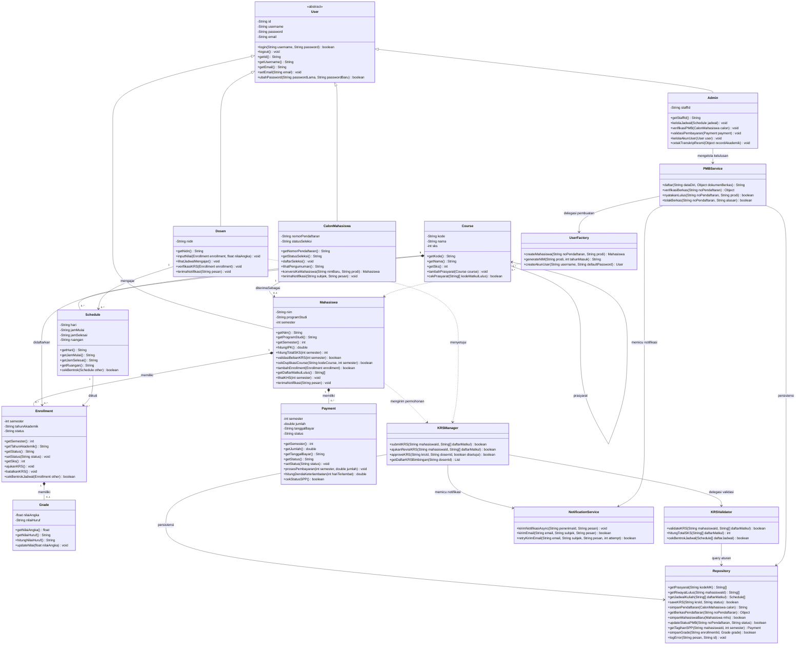

# SEVIMA Mini - Sistem Informasi Akademik Kampus Kecil

> Perancangan dan Pemodelan Arsitektur Berorientasi Objek (OOP) Berbasis Prinsip SOLID dan Standar UML Formal.

**Pengembang:** Zainun Kamal Ramadhan  
**NIM:** 263636001  
**Institusi:** Institut Sains dan Teknologi Nasional (ISTN)  

---

## 📌 Ringkasan Proyek

**SEVIMA Mini** adalah rancangan sistem informasi akademik kampus skala kecil yang dirancang untuk mengelola seluruh siklus operasional akademik mahasiswa dari proses penerimaan hingga kelulusan. Sistem ini mencakup 5 modul fungsional inti:

1. **PMB (Penerimaan Mahasiswa Baru):** Pendaftaran seleksi calon mahasiswa, pengumuman hasil seleksi, dan transisi siklus hidup (*lifecycle conversion*) menjadi mahasiswa aktif.
2. **KRS (Kartu Rencana Studi):** Pengambilan mata kuliah tiap semester, verifikasi prasyarat, validasi beban maksimal 24 SKS, serta pencegahan pendaftaran ganda.
3. **Penjadwalan Kuliah (Schedule):** Manajemen alokasi hari, jam mulai/selesai, ruangan kuliah, penugasan dosen pengajar, dan validasi bentrok jadwal riil mahasiswa.
4. **Penilaian Akademik (Grade & KHS):** Penginputan nilai angka/huruf oleh dosen, penerbitan Kartu Hasil Studi (KHS), dan kalkulasi Indeks Prestasi Kumulatif (IPK).
5. **Pembayaran SPP (Payment):** Pencatatan tagihan semesteran, validasi status pembayaran lunas/menunggak oleh Admin, serta integrasi syarat administrasi akademik.

---

## 🏛️ Prinsip Desain & Standar Arsitektur

Arsitektur kelas pada SEVIMA Mini dibangun dengan mematuhi kaidah rekayasa perangkat lunak modern:

- **SOLID Principles:**
  - *Single Responsibility Principle (SRP):* Setiap entitas hanya bertanggung jawab pada domain fungsionalnya sendiri, dengan pembatasan ketat $\le 10$ method per kelas.
  - *Dependency Inversion & Loose Coupling:* Memutus ketergantungan siklik (*circular dependency*) dua arah antara modul `Course` dan `Mahasiswa` melalui penyederhanaan antarmuka verifikasi prasyarat.
- **Enkapsulasi Ketat (*Information Hiding*):**
  - Seluruh atribut pada 10 kelas dideklarasikan sebagai `private (-)`.
  - Manipulasi dan pembacaan state objek hanya dilakukan melalui method publik (`+`) accessor/mutator yang tervalidasi.
- **Pola Kelas Perantara (*Junction Entity Pattern*):**
  - Mengurai relasi *many-to-many* antara `Mahasiswa` dan `Course` menjadi dua relasi *one-to-many* yang ternormalisasi melalui kelas perantara `Enrollment`.
  - Keputusan arsitektur ini didokumentasikan secara formal dalam [ADR-001.pdf](file:///home/zainun/git/istn/sevima-mini/documents/ADR-001.pdf).
- **Semantik Relasi UML Formal:**
  - **Komposisi (`*--`):** Relasi kepemilikan kuat berbasis siklus hidup (*lifecycle dependency*), yaitu `Mahasiswa *-- Enrollment`, `Enrollment *-- Grade`, dan `Course *-- Schedule`.
  - **Asosiasi Referensial (`-->`):** Relasi referensi antar entitas independen, yaitu `Course --> Enrollment`, `Schedule --> Enrollment`, `Dosen --> Schedule`, `CalonMahasiswa --> Mahasiswa`, dan relasi prasyarat *self-referencing* `Course --> Course`.
  - **Pewarisan / Generalisasi (`<|--`):** Pewarisan murni yang lolos uji *is-a*, yaitu `User <|-- Mahasiswa`, `User <|-- Dosen`, `User <|-- Admin`, dan `User <|-- CalonMahasiswa`.

---

## 📂 Struktur Repositori

```
sevima-mini/
├── README.md                     # Dokumentasi utama proyek
├── diagram/                      # Artefak kode diagram dan spesifikasi teknis
│   ├── class-diagram.mmd         # Kode sumber Mermaid class diagram (Versi 5 - Layered Architecture)
│   ├── class-diagram.md          # Spesifikasi rinci atribut, method, relasi, dan aturan bisnis
│   ├── use-case-diagram.puml     # Kode sumber PlantUML Use Case Diagram (Versi 2)
│   ├── use-case-diagram.md       # Spesifikasi formal use case, aktor, dan relasi include/extend
│   ├── krs-sequence-diagram.mmd  # Kode sumber Sequence Diagram Pengisian & Validasi KRS
│   ├── krs-sequence-diagram.md   # Spesifikasi alur validasi komprehensif & error accumulator
│   ├── pmb-sequence-diagram.mmd  # Kode sumber Sequence Diagram PMB
│   ├── pmb-sequence-diagram.md   # Spesifikasi alur PMB, factory pattern, & resilient notification
│   ├── krs-approval-sequence-diagram.mmd # Kode sumber Sequence Diagram Persetujuan & Revisi KRS
│   ├── krs-approval-sequence-diagram.md  # Spesifikasi alur Approve & Revisi KRS
│   ├── payment-sequence-diagram.mmd      # Kode sumber Sequence Diagram Pembayaran SPP & Denda
│   ├── payment-sequence-diagram.md       # Spesifikasi alur transaksi keuangan & denda keterlambatan
│   ├── grading-transcript-sequence-diagram.mmd # Kode sumber Sequence Diagram Penilaian & Transkrip
│   └── grading-transcript-sequence-diagram.md  # Spesifikasi alur input nilai & penerbitan transkrip
├── perbaikan/                    # Riwayat perbaikan dan bukti visual evolusi diagram
│   ├── README.md                 # Dokumentasi komparasi perubahan antar versi
│   ├── minggu-01/                # Bukti visual evolusi Class Diagram Minggu 1 (Versi 1-4)
│   │   ├── diagram_sebelum_dirubah.png  # Versi 1 (Draft awal AI)
│   │   ├── diagram_sesudah_dirubah.png  # Versi 2 (Enkapsulasi penuh & hitungIPK)
│   │   ├── diagram_versi_3.png          # Versi 3 (Refactoring relasi & kardinalitas)
│   │   └── diagram_versi_4.png          # Versi 4 (Perbaikan arsitektur kritis 1-4)
│   └── minggu-02/                # Bukti visual pemodelan dinamis & sinkronisasi Minggu 2
│       ├── class_diagram_versi_5.png    # Screenshot Class Diagram Versi 5
│       ├── use_case_versi_2.png         # Screenshot Use Case Diagram Versi 2
│       ├── krs_sequence_diagram_versi_2.png # Screenshot Sequence Validasi KRS
│       ├── pmb_sequence_diagram_versi_2.png # Screenshot Sequence PMB
│       ├── krs_approval_sequence_diagram_versi_1.png # Screenshot Sequence Approve/Revisi KRS
│       ├── payment_sequence_diagram_versi_1.png      # Screenshot Sequence Pembayaran SPP
│       └── grading_transcript_sequence_diagram_versi_1.png # Screenshot Sequence Penilaian/Transkrip
├── documents/                    # Dokumen keputusan arsitektural (ADR)
│   └── ADR-001.pdf               # ADR: Pemecahan Relasi M:N dengan Kelas Perantara Enrollment
└── logs/                         # Catatan transparansi penggunaan AI
    └── ai-usage-log.md           # Log interaksi AI dengan kerangka OPAR (Observe-Plan-Act-Reflect)
```

---

## 📊 Class Diagram Terkini (Versi 5 - Integrasi Arsitektur Berlapis)

Diagram kelas berikut merepresentasikan arsitektur berlapis (*Layered Architecture*) yang telah diselaraskan penuh dengan seluruh pemodelan dinamis Use Case dan Sequence Diagram:



---

## 🔄 Ringkasan Evolusi Arsitektur

| Evaluasi Arsitektural | Versi 1 (Draft Awal) | Versi 2 (Enkapsulasi) | Versi 3 (Relational) | Versi 4 (Final Refactor) |
| :--- | :--- | :--- | :--- | :--- |
| **Enkapsulasi Atribut** | `protected (#)` | `private (-)` | `private (-)` | `private (-)` |
| **Method `hitungIPK()`** | Belum ada | Ada di `Mahasiswa` | Ada di `Mahasiswa` | Ada di `Mahasiswa` |
| **Keterhubungan `Schedule`** | Hanya ke `Course` | Hanya ke `Course` | Hanya ke `Course` | **Terhubung ke `Enrollment` & `Dosen`** |
| **Siklus Hidup PMB** | Subclass kaku | Subclass kaku | Subclass kaku | **Asosiasi & Method Konversi ke `Mahasiswa`** |
| **Coupling `Course`-`Mahasiswa`**| Ketergantungan Siklik | Ketergantungan Siklik | Ketergantungan Siklik | **Terputus via parameter `String[]`** |
| **Tanggung Jawab KRS** | Ambigu | Ambigu | Ambigu | **Delegasi SKS via Enrollment & Validasi Semester** |

Rincian lengkap dan perbandingan visual dapat dilihat pada [perbaikan/README.md](file:///home/zainun/git/istn/sevima-mini/perbaikan/README.md).

---

## 📜 Architectural Decision Record (ADR)

Keputusan desain arsitektural penting dicatat menggunakan format ADR resmi:
- **[ADR-001: Memecah Relasi Many-to-Many Mahasiswa-Course Menggunakan Kelas Perantara Enrollment](file:///home/zainun/git/istn/sevima-mini/documents/ADR-001.pdf):** Menjelaskan analisis konteks, alternatif opsi (relasi langsung vs perantara), pertimbangan trade-off, serta catatan peran revisi manual manusia terhadap saran AI.

---

## 🤖 Catatan Transparansi Penggunaan AI

Seluruh interaksi bersama AI (Gemini 3.8 Flash) dicatat secara transparan pada [logs/ai-usage-log.md](file:///home/zainun/git/istn/sevima-mini/logs/ai-usage-log.md) dengan menerapkan siklus refleksi **OPAR (Observe - Plan - Act - Reflect)** untuk setiap iterasi prompt (Prompt #1 hingga #4).

---

## 🔗 Tautan Dokumen & Berkas Cepat

- [README Perbaikan & Screenshot Evolusi](file:///home/zainun/git/istn/sevima-mini/perbaikan/README.md)
- [Spesifikasi Class Diagram Lengkap](file:///home/zainun/git/istn/sevima-mini/diagram/class-diagram.md)
- [Source Code Mermaid Class Diagram](file:///home/zainun/git/istn/sevima-mini/diagram/class-diagram.mmd)
- [Dokumen Keputusan Arsitektur ADR-001 (PDF)](file:///home/zainun/git/istn/sevima-mini/documents/ADR-001.pdf)
- [Log Penggunaan AI (OPAR)](file:///home/zainun/git/istn/sevima-mini/logs/ai-usage-log.md)
