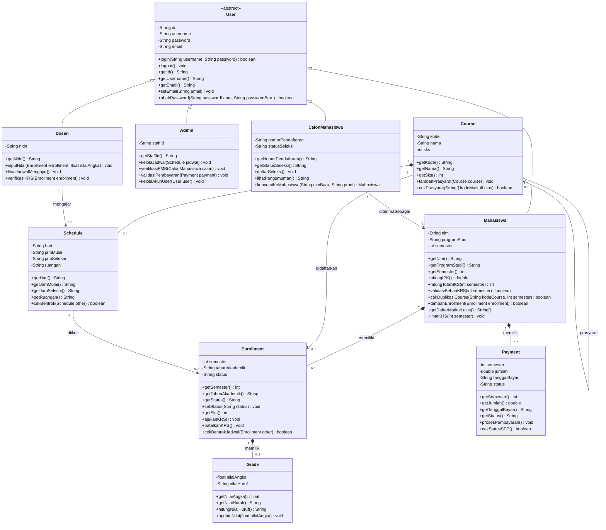

# Class Diagram UML - SEVIMA Mini (Versi 4: Perbaikan Arsitektur Kritis 1-4)

Diagram kelas UML untuk sistem informasi akademik kampus kecil **SEVIMA Mini** yang telah disempurnakan berdasarkan hasil kritik arsitektural terhadap kelemahan kritis 1 hingga 4.

## Spesifikasi Solusi Perbaikan Arsitektur (Versi 4)

### 1. Solusi Masalah 1: Integrasi Jadwal Riil (`Schedule`, `Enrollment`, `Dosen`)
- **`Schedule "1" --> "0..*" Enrollment : diikuti`**: `Enrollment` (KRS) kini terhubung langsung ke sesi alokasi `Schedule`. Mahasiswa mengetahui ruang dan jam perkuliahan secara pasti, dan `Enrollment.cekBentrokJadwal(other)` dapat dijalankan dengan akurat.
- **`Dosen "1" --> "0..*" Schedule : mengajar`**: Dosen terhubung langsung ke sesi jadwal, sehingga fungsionalitas `Dosen.lihatJadwalMengajar()` memiliki sumber data yang valid untuk ruang dan waktu mengajar.

### 2. Solusi Masalah 2: Penanganan Transisi Siklus Hidup `CalonMahasiswa` $\rightarrow$ `Mahasiswa`
- **Method `konversiKeMahasiswa(String nimBaru, String prodi): Mahasiswa`**: Mengakomodasi mutasi peran calon mahasiswa yang diterima menjadi mahasiswa resmi tanpa merusak identitas akun atau membuat kelas di luar requirement.
- **Relasi Asosiasi `CalonMahasiswa "1" --> "0..1" Mahasiswa : diterimaSebagai`**: Menghubungkan riwayat pendaftaran PMB dengan entitas mahasiswa yang terdaftar.

### 3. Solusi Masalah 3: Pemutusan Ketergantungan Siklik (*Circular Dependency*)
- **`Course.cekPrasyarat(String[] kodeMatkulLulus)`**: Menggantikan parameter `Mahasiswa` dengan array kode mata kuliah lulus (`String[]`).
- `Course` kini sepenuhnya terisolasi dan mandiri (tidak lagi bergantung pada representasi data kelas `Mahasiswa`).

### 4. Solusi Masalah 4: Klarifikasi Tanggung Jawab Dokumen KRS & SKS
- **Delegasi SKS pada `Enrollment` (`+getSks(): int`)**: Memungkinkan penghitungan SKS langsung dari asosiasi mata kuliah.
- **Pengaturan Tanggung Jawab Semesteran pada `Mahasiswa`**: Menambahkan parameter semester pada `hitungTotalSKS(semester)`, `validasiBebanKRS(semester)` (maks 24 SKS), dan `cekDuplikasiCourse(kodeCourse, semester)`.
