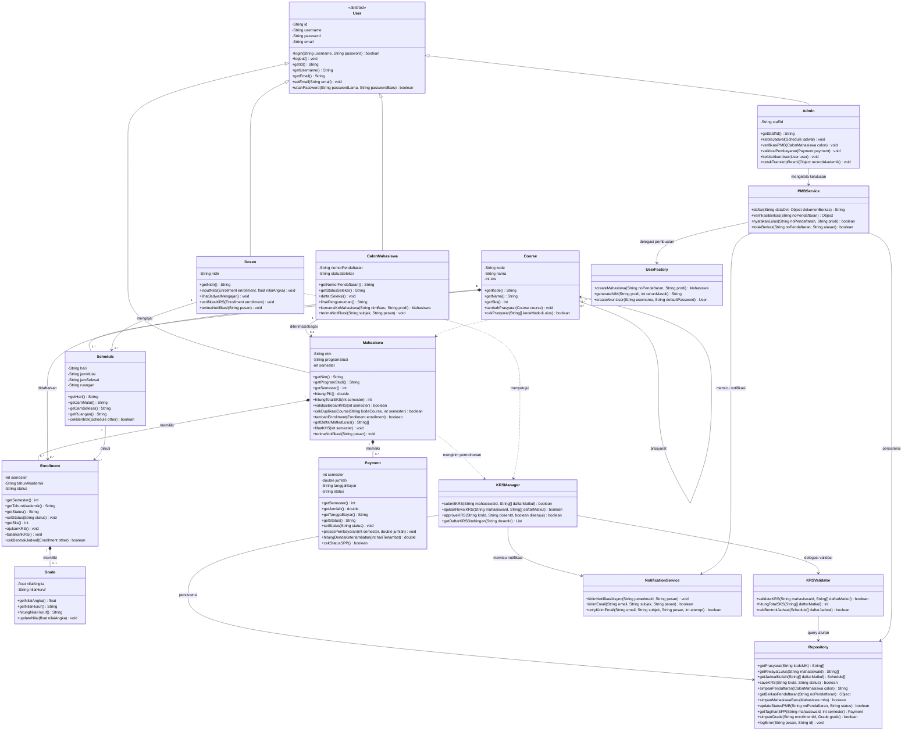

# Class Diagram UML - SEVIMA Mini (Versi 5: Integrasi Arsitektur Berlapis)

Diagram kelas UML untuk sistem informasi akademik kampus kecil **SEVIMA Mini** yang telah disempurnakan berdasarkan temuan sinkronisasi pemodelan dinamis (Opsi A: Integrasi Layered Architecture, Application Service, Factory, Data Access, dan Infrastructure).

---

## 🛠️ Kode Sumber Mermaid (Versi 5)

---

## 🏛️ Spesifikasi Komponen Layered Architecture (Opsi A)

1. **Application Service / Controller Layer (`KRSManager`, `PMBService`):**
   - Bertindak sebagai orkestrator transaksi use case antara antarmuka pengguna (aktor) dan model domain.
   - Mengisolasi kompleksitas transaksi pengajuan KRS dan alur seleksi berkas PMB.
2. **Domain Service Layer (`KRSValidator`):**
   - Menjalankan logika validasi lintas entitas (prasyarat kelulusan, batasan 24 SKS, pencegahan tabrakan jam kuliah).
   - Mengumpulkan seluruh catatan kegagalan aturan (*Error Accumulator Pattern*).
3. **Creational Factory Layer (`UserFactory`):**
   - Mengenkapsulasi instansiasi objek `Mahasiswa`, kalkulasi algoritma format `NIM`, serta pembuatan akun `User` baru secara aman.
4. **Data Access / Persistence Layer (`Repository`):**
   - Mengabstraksikan penyimpanan dan pengambilan entitas `Enrollment`, `Course`, `Grade`, `Payment`, dan `CalonMahasiswa`.
5. **Infrastructure Layer (`NotificationService`):**
   - Menangani pengiriman email dan notifikasi push antarmuka secara asinkron (*non-blocking fire-and-forget*).
