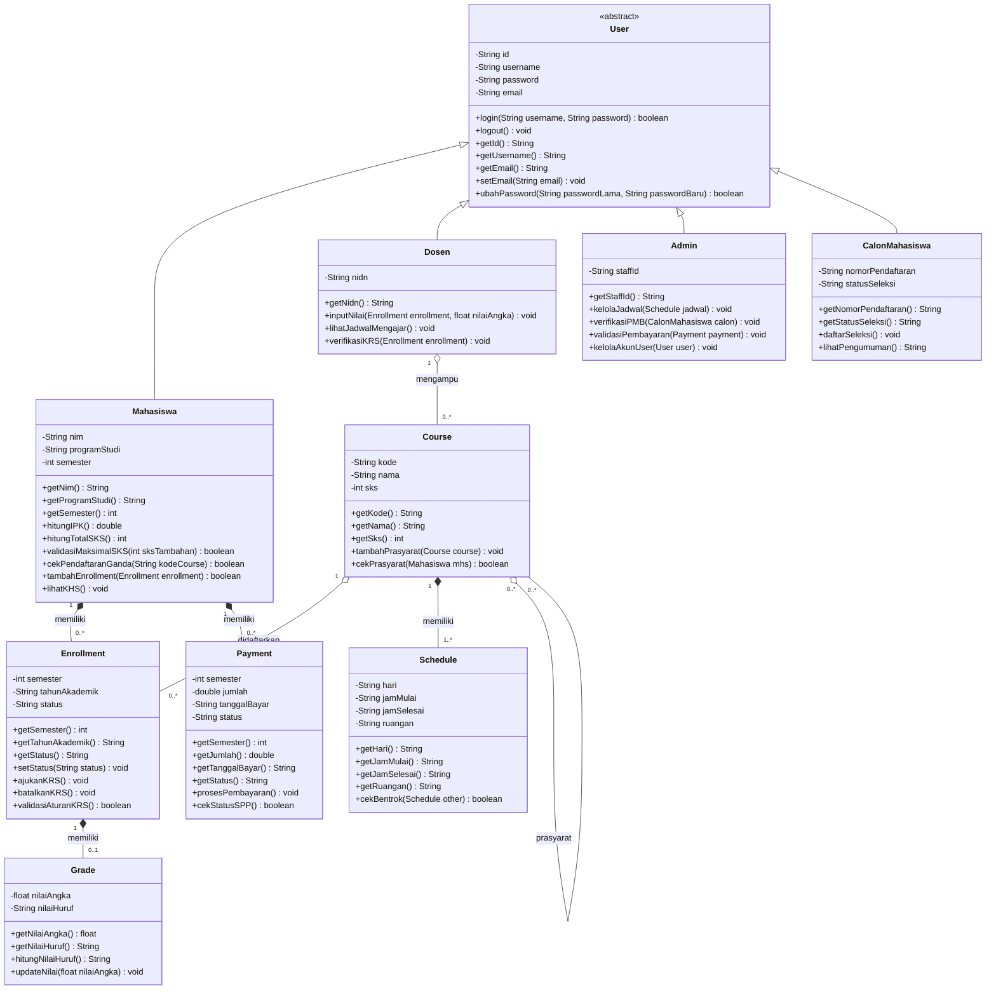

# Class Diagram UML - SEVIMA Mini

Diagram kelas UML untuk sistem informasi akademik kampus kecil **SEVIMA Mini** yang mencakup modul PMB, KRS, Jadwal, Nilai, dan Pembayaran SPP.

## Spesifikasi & Desain OOP

### 1. Prinsip SOLID & Enkapsulasi
- **Single Responsibility Principle (SRP):** Setiap kelas memiliki tanggung jawab tunggal dengan jumlah method $\le 9$ (tidak ada kelas $> 10$ method).
- **Enkapsulasi:** Seluruh atribut ber-visibility private (`-`) dengan tipe data eksplisit, dan diakses secara terkontrol melalui method public (`+`).
- **Penempatan `hitungIPK()`:** Ditempatkan khusus pada kelas `Mahasiswa` (bukan di `User`).

### 2. Hubungan Antar Kelas & Kardinalitas
- **Inheritance (`<|--`):** `User` sebagai abstract class diturunkan ke `Mahasiswa`, `Dosen`, `Admin`, dan `CalonMahasiswa`.
- **Composition (`*--`) Relasi Kuat:**
  - `Mahasiswa "1" *-- "0..*"` `Enrollment`: Riwayat enrollment terikat kuat pada siklus hidup data mahasiswa.
  - `Enrollment "1" *-- "0..1"` `Grade`: Nilai tidak dapat berdiri sendiri tanpa enrollment.
  - `Mahasiswa "1" *-- "0..*"` `Payment`: Catatan tagihan SPP terikat pada mahasiswa.
  - `Course "1" *-- "1..*"` `Schedule`: Jadwal perkuliahan terikat pada penawaran mata kuliah.
- **Aggregation (`o--`) Relasi Lemah:**
  - `Course "0..*" o-- "0..*"` `Course`: Relasi mata kuliah prasyarat (independent lifecycle).
  - `Course "1" o-- "0..*"` `Enrollment`: Mata kuliah di katalog bersifat independen dari pendaftaran mahasiswa.
  - `Dosen "1" o-- "0..*"` `Course`: Dosen pengampu mengajar mata kuliah.
- **Many-to-Many Resolution:** Relasi many-to-many antara `Mahasiswa` dan `Course` dipecah melalui kelas perantara `Enrollment`.

### 3. Aturan Bisnis
- **Maksimal 24 SKS:** Diimplementasikan melalui method `validasiMaksimalSKS(int sksTambahan)` pada `Mahasiswa` dan `validasiAturanKRS()` pada `Enrollment`.
- **Pencegahan Pendaftaran Ganda:** Diimplementasikan melalui method `cekPendaftaranGanda(String kodeCourse)` pada `Mahasiswa`.
