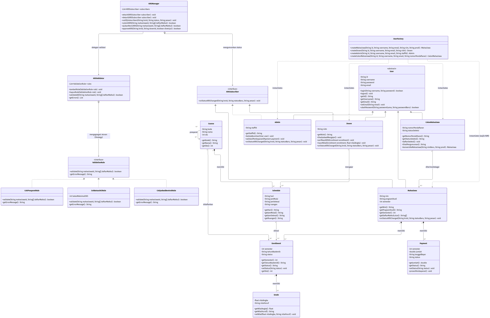

# Class Diagram UML - SEVIMA Mini (Versi 7: Integrasi Design Patterns)

Diagram kelas UML sistem informasi akademik kampus kecil **SEVIMA Mini** yang telah dilengkapi tiga pola desain (*GoF Design Patterns*) fundamental: **Factory Method**, **Observer**, dan **Strategy** tanpa penambahan kelas berlebih.

---

## 📌 Bukti Visual Diagram (Versi 7)

---

## 🛠️ Kode Sumber Mermaid (Versi 7)

Kode sumber tersimpan di [class-diagram.mmd](class-diagram.mmd):

```mermaid
classDiagram
    %% ==========================================
    %% PATTERN 2: OBSERVER INTERFACE (Subscriber)
    %% ==========================================
    class KRSSubscriber {
        <<interface>>
        +onStatusKRSChanged(String krsId, String statusBaru, String pesan) void
    }

    %% ==========================================
    %% PATTERN 3: STRATEGY INTERFACE & RULES
    %% ==========================================
    class ValidationRule {
        <<interface>>
        +validate(String mahasiswaId, String[] daftarMatkul) boolean
        +getErrorMessage() String
    }

    class CekPrasyaratRule {
        +validate(String mahasiswaId, String[] daftarMatkul) boolean
        +getErrorMessage() String
    }

    class CekBatasSKSRule {
        -int batasMaksimalSKS
        +validate(String mahasiswaId, String[] daftarMatkul) boolean
        +getErrorMessage() String
    }

    class CekJadwalBentrokRule {
        +validate(String mahasiswaId, String[] daftarMatkul) boolean
        +getErrorMessage() String
    }

    %% ==========================================
    %% CORE ENTITIES & OBSERVER IMPLEMENTATIONS
    %% ==========================================
    class User {
        <<abstract>>
        -String id
        -String username
        -String password
        -String email
        +login(String username, String password) boolean
        +logout() void
        +getId() String
        +getUsername() String
        +getEmail() String
        +setEmail(String email) void
        +ubahPassword(String passwordLama, String passwordBaru) boolean
    }

    class Mahasiswa {
        -String nim
        -String programStudi
        -int semester
        +getNim() String
        +getProgramStudi() String
        +getSemester() int
        +getDaftarMatkulLulus() String[]
        +onStatusKRSChanged(String krsId, String statusBaru, String pesan) void
    }

    class Dosen {
        -String nidn
        +getNidn() String
        +lihatJadwalMengajar() void
        +verifikasiKRS(Enrollment enrollment) void
        +inputNilai(Enrollment enrollment, float nilaiAngka) void
        +onStatusKRSChanged(String krsId, String statusBaru, String pesan) void
    }

    class Admin {
        -String staffId
        +getStaffId() String
        +kelolaAkunUser(User user) void
        +validasiPembayaran(Payment payment) void
        +onStatusKRSChanged(String krsId, String statusBaru, String pesan) void
    }

    class CalonMahasiswa {
        -String nomorPendaftaran
        -String statusSeleksi
        +getNomorPendaftaran() String
        +getStatusSeleksi() String
        +daftarSeleksi() void
        +lihatPengumuman() String
        +konversiKeMahasiswa(String nimBaru, String prodi) Mahasiswa
    }

    class Course {
        -String kode
        -String nama
        -int sks
        +getKode() String
        +getNama() String
        +getSks() int
    }

    class Enrollment {
        -int semester
        -String tahunAkademik
        -String status
        +getSemester() int
        +getTahunAkademik() String
        +getStatus() String
        +setStatus(String status) void
        +getSks() int
    }

    class Schedule {
        -String hari
        -String jamMulai
        -String jamSelesai
        -String ruangan
        +getHari() String
        +getJamMulai() String
        +getJamSelesai() String
        +getRuangan() String
    }

    class Grade {
        -float nilaiAngka
        -String nilaiHuruf
        +getNilaiAngka() float
        +getNilaiHuruf() String
        +setNilai(float nilaiAngka, String nilaiHuruf) void
    }

    class Payment {
        -int semester
        -double jumlah
        -String tanggalBayar
        -String status
        +getJumlah() double
        +getStatus() String
        +setStatus(String status) void
        +prosesPembayaran() void
    }

    %% ==========================================
    %% PATTERN 1: FACTORY
    %% ==========================================
    class UserFactory {
        +createMahasiswa(String id, String username, String email, String nim, String prodi) Mahasiswa
        +createDosen(String id, String username, String email, String nidn) Dosen
        +createAdmin(String id, String username, String email, String staffId) Admin
        +createCalonMahasiswa(String id, String username, String email, String nomorPendaftaran) CalonMahasiswa
    }

    %% ==========================================
    %% OBSERVER SUBJECT & STRATEGY CONTEXT
    %% ==========================================
    class KRSManager {
        -List~KRSSubscriber~ subscribers
        +attach(KRSSubscriber subscriber) void
        +detach(KRSSubscriber subscriber) void
        +notifySubscribers(String krsId, String status, String pesan) void
        +submitKRS(String mahasiswaId, String[] daftarMatkul) boolean
        +ajukanRevisiKRS(String mahasiswaId, String[] daftarMatkul) boolean
        +approveKRS(String krsId, String dosenId, boolean disetujui) boolean
    }

    class KRSValidator {
        -List~ValidationRule~ rules
        +tambahRule(ValidationRule rule) void
        +hapusRule(ValidationRule rule) void
        +validateAll(String mahasiswaId, String[] daftarMatkul) boolean
        +getErrors() List
    }

    %% ==========================================
    %% INHERITANCE & IMPLEMENTATIONS
    %% ==========================================
    User <|-- Mahasiswa
    User <|-- Dosen
    User <|-- Admin
    User <|-- CalonMahasiswa

    KRSSubscriber <|.. Mahasiswa
    KRSSubscriber <|.. Dosen
    KRSSubscriber <|.. Admin

    ValidationRule <|.. CekPrasyaratRule
    ValidationRule <|.. CekBatasSKSRule
    ValidationRule <|.. CekJadwalBentrokRule

    %% ==========================================
    %% ASSOCIATIONS & DEPENDENCIES
    %% ==========================================
    Mahasiswa "1" *-- "0..*" Enrollment : memiliki
    Enrollment "1" *-- "0..1" Grade : memiliki
    Mahasiswa "1" *-- "0..*" Payment : memiliki
    Course "1" *-- "0..*" Schedule : memiliki
    Course "1" --> "0..*" Enrollment : didaftarkan
    Schedule "1" --> "0..*" Enrollment : diikuti
    Dosen "1" --> "0..*" Schedule : mengajar
    Course "0..*" --> "0..*" Course : prasyarat
    CalonMahasiswa "1" --> "0..1" Mahasiswa : diterimaSebagai

    UserFactory ..> Mahasiswa : instantiates (wajib NIM)
    UserFactory ..> Dosen : instantiates
    UserFactory ..> Admin : instantiates
    UserFactory ..> CalonMahasiswa : instantiates

    KRSManager o--> KRSSubscriber : mengumumkan status
    KRSManager --> KRSValidator : delegasi validasi
    KRSValidator o--> ValidationRule : mengagregasi aturan (Strategy)
```

---

## 🏛️ Spesifikasi 3 Pola Desain (*Design Patterns*)

### 1. Factory Pattern (`UserFactory`)
- **Tanggung Jawab:** Memusatkan logika instansiasi seluruh turunan `User` (`Mahasiswa`, `Dosen`, `Admin`, `CalonMahasiswa`).
- **Invarian Bisnis:** Memastikan objek `Mahasiswa` **selalu dibuat dengan menyertakan NIM valid** sejak pertama kali diinstansiasi (`createMahasiswa(..., nim, ...)`), mencegah instansiasi mahasiswa tanpa identitas akademik resmi.

### 2. Observer Pattern (`KRSSubscriber` & `KRSManager`)
- **Subject / Publisher (`KRSManager`):** Mengelola daftar observer dan memicu `notifySubscribers()` saat status pengajuan KRS mengalami transisi (`pending approval`, `disetujui`, `ditolak_perlu_revisi`).
- **Observer / Subscriber (`KRSSubscriber`):** Diimplementasikan oleh `Mahasiswa` (pemilik KRS), `Dosen` (Dosen PA), dan `Admin` (bagian akademik), memungkinkan pembaruan status terkirim secara otomatis dengan kopling longgar (*loose coupling*).

### 3. Strategy Pattern (`ValidationRule` & `KRSValidator`)
- **Strategy Interface (`ValidationRule`):** Menstandarkan kontrak validasi dengan method `validate(mahasiswaId, daftarMatkul): boolean` dan `getErrorMessage(): String`.
- **Concrete Strategies:** `CekPrasyaratRule` (kelulusan mata kuliah prasyarat), `CekBatasSKSRule` (beban maksimal 24 SKS), dan `CekJadwalBentrokRule` (bentrok jam/ruangan kelas).
- **Kepatuhan Open/Closed Principle (OCP):** Aturan baru seperti **`CekTunggakanRule`** dapat ditambahkan ke `KRSValidator` tanpa mengubah kode yang sudah ada.
