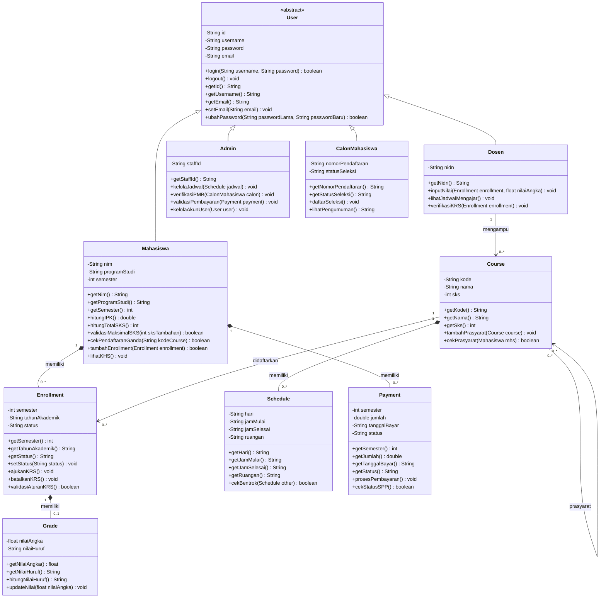

# Class Diagram UML - SEVIMA Mini (Versi 3: Refactor Relasi)

Diagram kelas UML untuk sistem informasi akademik kampus kecil **SEVIMA Mini** yang mencakup modul PMB, KRS, Jadwal, Nilai, dan Pembayaran SPP setelah dilakukan evaluasi uji wadah (*lifecycle dependency*) dan uji *is-a*.

## Spesifikasi & Desain OOP (Versi 3)

### 1. Prinsip SOLID & Enkapsulasi
- **Single Responsibility Principle (SRP):** Setiap kelas memiliki tanggung jawab tunggal dengan jumlah method $\le 9$ (tidak ada kelas $> 10$ method).
- **Enkapsulasi:** Seluruh atribut ber-visibility private (`-`) dengan tipe data eksplisit, dan diakses secara terkontrol melalui method public (`+`).
- **Penempatan `hitungIPK()`:** Ditempatkan khusus pada kelas `Mahasiswa` (bukan di `User`).

### 2. Hubungan Antar Kelas & Kardinalitas (Hasil Uji Wadah & Is-A)
- **Inheritance (`<|--`):** `User` sebagai abstract class diturunkan ke `Mahasiswa`, `Dosen`, `Admin`, dan `CalonMahasiswa` (lulus uji *is-a*).
- **Composition (`*--`) Relasi Kuat (Wadah hilang $\rightarrow$ Bagian ikut hilang):**
  - `Mahasiswa "1" *-- "0..*"` `Enrollment`: Riwayat enrollment terikat mutlak pada siklus hidup data mahasiswa.
  - `Enrollment "1" *-- "0..1"` `Grade`: Nilai tidak dapat berdiri sendiri tanpa enrollment.
  - `Mahasiswa "1" *-- "0..*"` `Payment`: Catatan tagihan SPP terikat pada mahasiswa.
  - `Course "1" *-- "0..*"` `Schedule`: Alokasi jadwal perkuliahan terikat pada penawaran mata kuliah (kardinalitas `0..*` mengakomodasi matkul baru di katalog).
- **Association (`-->`) Relasi Referensial/Peran (Bukan Wadah Whole-Part):**
  - `Course "1" --> "0..*"` `Enrollment`: Enrollment merujuk ke Course katalog, Course bukan wadah dari Enrollment.
  - `Course "0..*" --> "0..*"` `Course`: Relasi mata kuliah prasyarat (*self-referencing association* antar entitas setara).
  - `Dosen "1" --> "0..*"` `Course`: Asosiasi peran instruktur mengampu mata kuliah.
