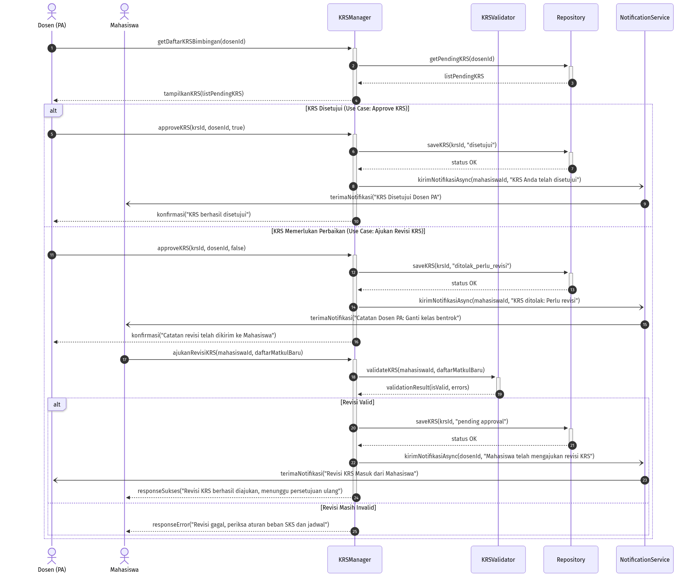
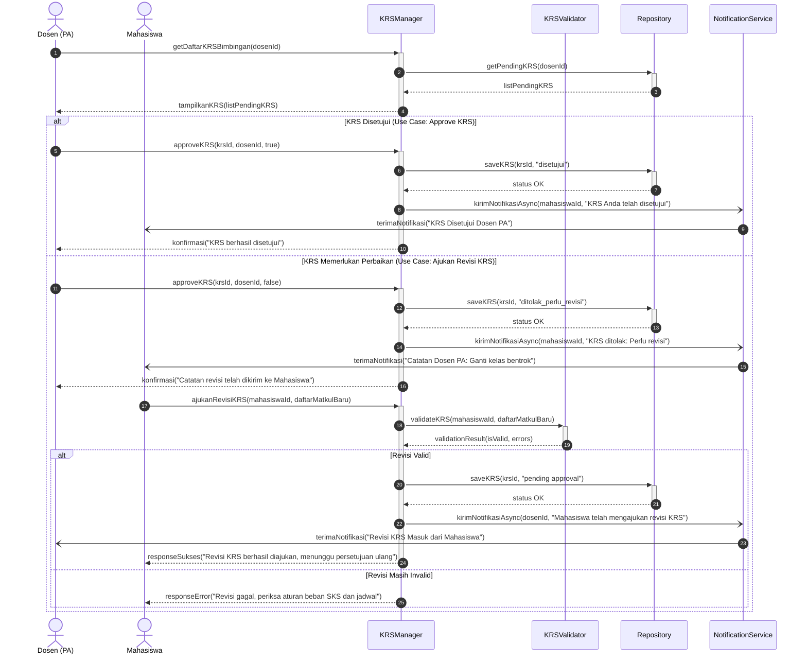

# Sequence Diagram - Persetujuan & Revisi KRS (Versi 1)

Diagram sequence UML berbasis Mermaid untuk alur proses **Persetujuan (Approve) & Pengajuan Revisi Kartu Rencana Studi (KRS)** oleh Dosen Pembimbing Akademik (PA) dan Mahasiswa pada sistem informasi akademik **SEVIMA Mini**.

---

## 📌 Bukti Visual Diagram

---

## 🛠️ Kode Sumber Mermaid

Kode sumber tersimpan di [krs-approval-sequence-diagram.mmd](krs-approval-sequence-diagram.mmd):

---

## 🏛️ Cakupan Use Case yang Disinkronkan
- **Use Case `Approve KRS`**: Dosen PA memvalidasi rencana studi mahasiswa bimbingan, mengubah status KRS menjadi disetujui, dan memicu notifikasi asinkron ke mahasiswa.
- **Use Case `Ajukan Revisi KRS`**: Dosen PA memberikan catatan revisi jika terdapat ketidaksesuaian rencana studi. Mahasiswa mengajukan perubahan mata kuliah (`ajukanRevisiKRS`), sistem memvalidasi ulang melalui `KRSValidator`, dan mengirimkan kembali status `pending approval` ke Dosen PA.
