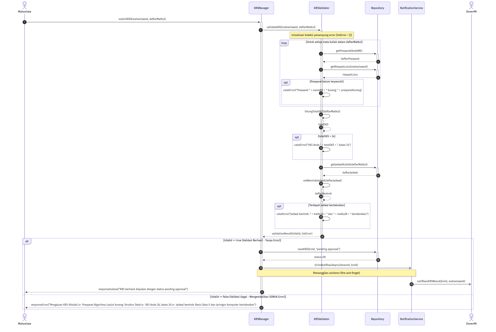
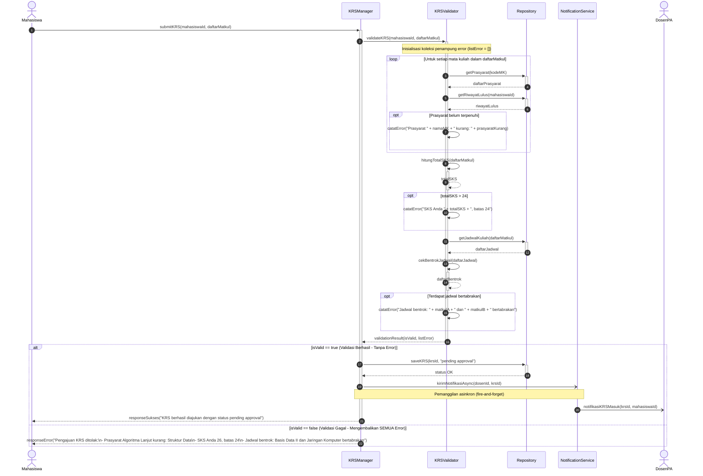

# Sequence Diagram - Validasi KRS (Versi 1)

Diagram sequence UML berbasis Mermaid untuk alur proses **Validasi Kartu Rencana Studi (KRS)** pada sistem informasi akademik kampus kecil **SEVIMA Mini**.

---

## 📌 Bukti Visual Diagram (Versi 1)

---

## 🛠️ Kode Sumber Mermaid

Kode sumber tersimpan di [krs-sequence-diagram.mmd](krs-sequence-diagram.mmd):

---

## 🏛️ Partisipan & Batas Peran (*Roles & Responsibilities*)

| Partisipan | Peran Arsitektural | Tanggung Jawab Utama |
| :--- | :--- | :--- |
| **`Mahasiswa`** | *Actor (Initiator)* | Menginisiasi pengajuan rencana studi dengan mengirim daftar mata kuliah pilihan. |
| **`KRSManager`** | *Application Controller / Service Facade* | Mengorkestrasikan alur pengajuan, mendelegasikan validasi, menyimpan data, dan memicu notifikasi. |
| **`KRSValidator`** | *Domain Service (Business Rules)* | Menjalankan logika validasi komprehensif (prasyarat, batas 24 SKS, jadwal bentrok) dan menampung semua error (*error accumulator*). |
| **`Repository`** | *Persistence Layer (Data Access)* | Menyediakan query prasyarat matkul, riwayat kelulusan mahasiswa, jadwal kuliah, serta penyimpanan status KRS. |
| **`NotificationService`** | *Infrastructure / Integration Service* | Menangani pengiriman notifikasi antar-aktor secara non-blocking (*asynchronous*). |
| **`DosenPA`** | *Actor (Recipient / Approver)* | Menerima pemberitahuan pengajuan KRS mahasiswa bimbingan untuk ditinjau (*pending approval*). |

---

## 🔍 Detail Alur & Logika Validasi

1. **Pengumpulan Semua Error (*Error Accumulator Pattern*):**
   - Validasi tidak langsung berhenti (*fail-fast*) pada error pertama, melainkan mengevaluasi seluruh aturan dan mengumpulkan semua pesan kesalahan dalam satu koleksi (`listError`).
   - Dengan pendekatan ini, mahasiswa mendapatkan umpan balik komprehensif dalam satu kali pengajuan.

2. **Tiga Lapisan Validasi Mandatori:**
   - **Cek Prasyarat (Fragmen `loop`):** Melakukan iterasi terhadap setiap mata kuliah yang dipilih dan mencocokkan prasyaratnya dengan riwayat mata kuliah yang telah lulus di `Repository`.
   - **Batas Beban SKS (Fragmen `opt` via *Self Call*):** Menghitung total akumulasi SKS semester berjalan. Jika melebihi batas maksimal 24 SKS, mencatat error dengan rincian total dan batasnya (mis. *"SKS Anda 26, batas 24"*).
   - **Cek Bentrok Jadwal (Fragmen `opt`):** Memeriksa tumpang tindih waktu (hari, jam mulai, jam selesai) antar alokasi kelas yang dipilih.

3. **Notifikasi Asinkron (`-)`):**
   - Menggunakan pemanggilan asinkron (*fire-and-forget*) dari `KRSManager` ke `NotificationService` agar *response time* pengajuan KRS mahasiswa tidak terhambat oleh proses pengiriman pesan ke Dosen PA.
