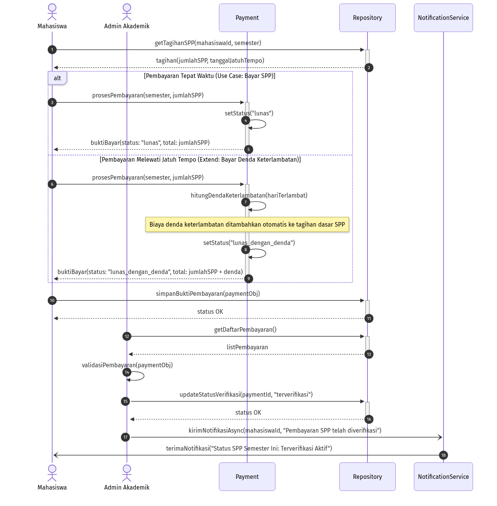
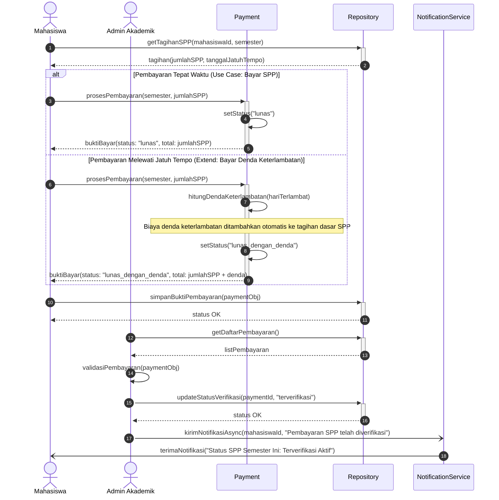

# Sequence Diagram - Pembayaran SPP & Denda (Versi 1)

Diagram sequence UML berbasis Mermaid untuk alur transaksi **Pembayaran SPP dan Penanganan Denda Keterlambatan** pada sistem informasi akademik **SEVIMA Mini**.

---

## 📌 Bukti Visual Diagram

---

## 🛠️ Kode Sumber Mermaid

Kode sumber tersimpan di [payment-sequence-diagram.mmd](payment-sequence-diagram.mmd):

---

## 🏛️ Cakupan Use Case yang Disinkronkan
- **Use Case `Bayar SPP`**: Mahasiswa membayar biaya perkuliahan sebelum jatuh tempo dan memperoleh bukti pembayaran lunas.
- **Use Case `Bayar Denda Keterlambatan` (Relasi `<<extend>>`)**: Jika pembayaran melewati batas tanggal jatuh tempo, use case diperluas dengan kalkulasi denda penalti keterlambatan yang diakumulasikan ke total tagihan.
- **Validasi Admin**: `Admin Akademik` memvalidasi status pembayaran agar mahasiswa memenuhi syarat administrasi untuk perwalian/KRS.
