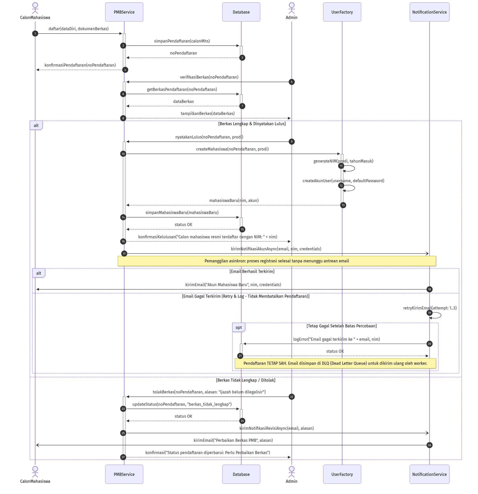
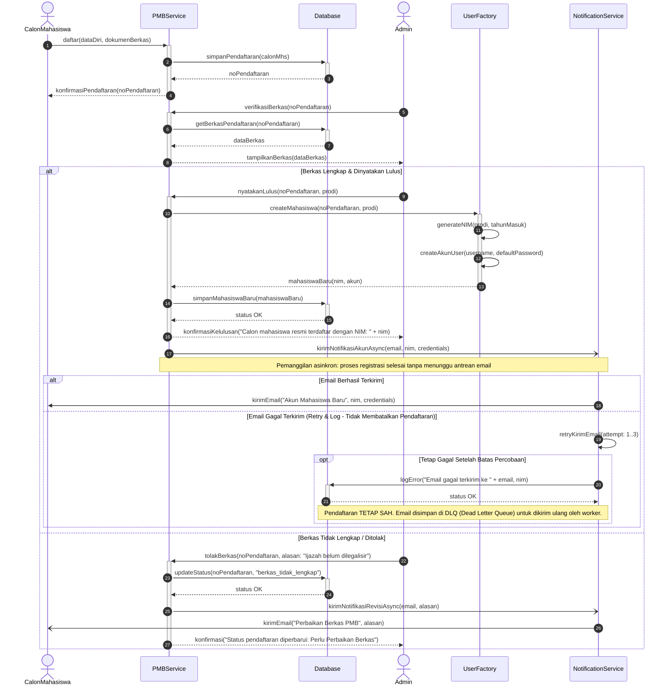

# Sequence Diagram - Pendaftaran Mahasiswa Baru / PMB (Versi 1)

Diagram sequence UML berbasis Mermaid untuk alur proses **Penerimaan Mahasiswa Baru (PMB)** pada sistem informasi akademik kampus kecil **SEVIMA Mini**.

---

## 📌 Bukti Visual Diagram (Versi 1)

---

## 🛠️ Kode Sumber Mermaid

Kode sumber tersimpan di [pmb-sequence-diagram.mmd](pmb-sequence-diagram.mmd):

---

## 🏛️ Partisipan & Batas Peran (*Roles & Responsibilities*)

| Partisipan | Peran Arsitektural | Tanggung Jawab Utama |
| :--- | :--- | :--- |
| **`CalonMahasiswa`** | *Actor (Initiator)* | Mengisi data diri, mengunggah berkas seleksi PMB, dan menerima nomor pendaftaran serta kredensial akun. |
| **`PMBService`** | *Application Service / Domain Facade* | Mengorkestrasikan alur pendaftaran, delegasi verifikasi berkas, pembuatan mahasiswa via factory, dan pemicu notifikasi. |
| **`Database`** | *Persistence Layer* | Menyimpan entitas pendaftaran, berkas calon mahasiswa, mutasi status, data entitas `Mahasiswa`, serta error log. |
| **`Admin`** | *Actor (Verifier & Decision Maker)* | Memeriksa validitas dokumen pendaftaran dan memutuskan kelulusan calon mahasiswa. |
| **`UserFactory`** | *Creational Pattern (GoF Factory)* | Mengenkapsulasi logika kompleks instansiasi objek `Mahasiswa`, kalkulasi format `NIM`, serta pembuatan kredensial awal akun `User`. |
| **`NotificationService`** | *Infrastructure Service* | Mengirimkan email notifikasi konfirmasi kelulusan dan kredensial akun secara asinkron dan andal (*resilient*). |

---

## 🔍 Detail Alur & Penanganan Alternate Flow

1. **Pemisahan Siklus Hidup Pendaftaran dan Penerimaan:**
   - Calon mahasiswa mendaftar dan segera memperoleh `nomor pendaftaran` sebagai tanda bukti registrasi awal.
   - Verifikasi dokumen dilakukan secara independen oleh `Admin`.

2. **Peran `UserFactory` (Pola Kreasi Berorientasi Objek):**
   - Transisi siklus hidup dari `CalonMahasiswa` menjadi `Mahasiswa` didelegasikan ke `UserFactory` untuk menjamin kepatuhan *Single Responsibility Principle* (SRP). `UserFactory` bertanggung jawab menghasilkan NIM unik berbasis tahun masuk dan kode program studi, serta akun autentikasi terenkapsulasi.

3. **Ketahanan Notifikasi Asinkron (*Resilient Notification Pattern*):**
   - Pemanggilan `NotificationService` dilakukan secara asinkron (`-)`), sehingga `PMBService` tidak terblokir oleh latensi protokol SMTP/Mail Gateway.
   - **Alternate Flow Kegagalan Email:** Jika transmisi email gagal, `NotificationService` melakukan mekanisme *retry* terencana (hingga 3 kali). Apabila tetap gagal, kegagalan dicatat ke tabel log error `Database` tanpa membatalkan transaksi pembuatan mahasiswa (*non-blocking failure isolation*). Mahasiswa tetap sah terdaftar dalam sistem akademik.

4. **Alternate Flow Berkas Tidak Lengkap:**
   - Admin memasukkan alasan spesifik (mis. *"Ijazah belum dilegalisir"*), sistem memperbarui status di `Database`, dan memicu notifikasi revisi ke calon mahasiswa untuk mengunggah ulang dokumen yang kurang.
