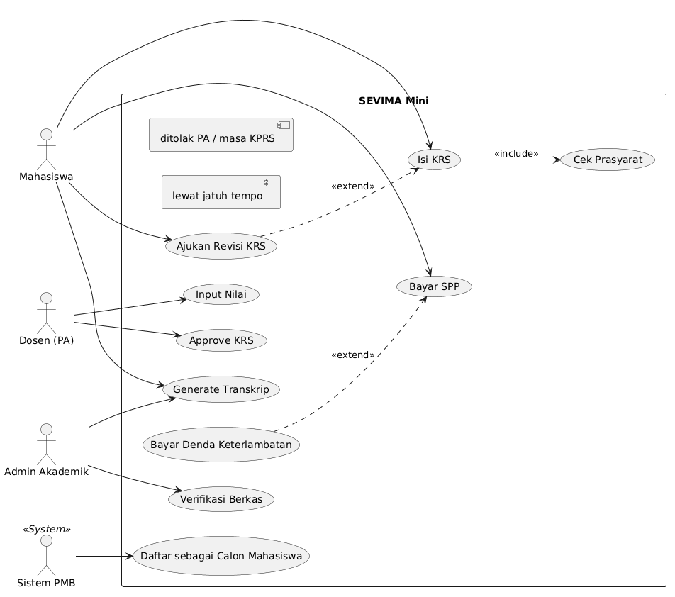
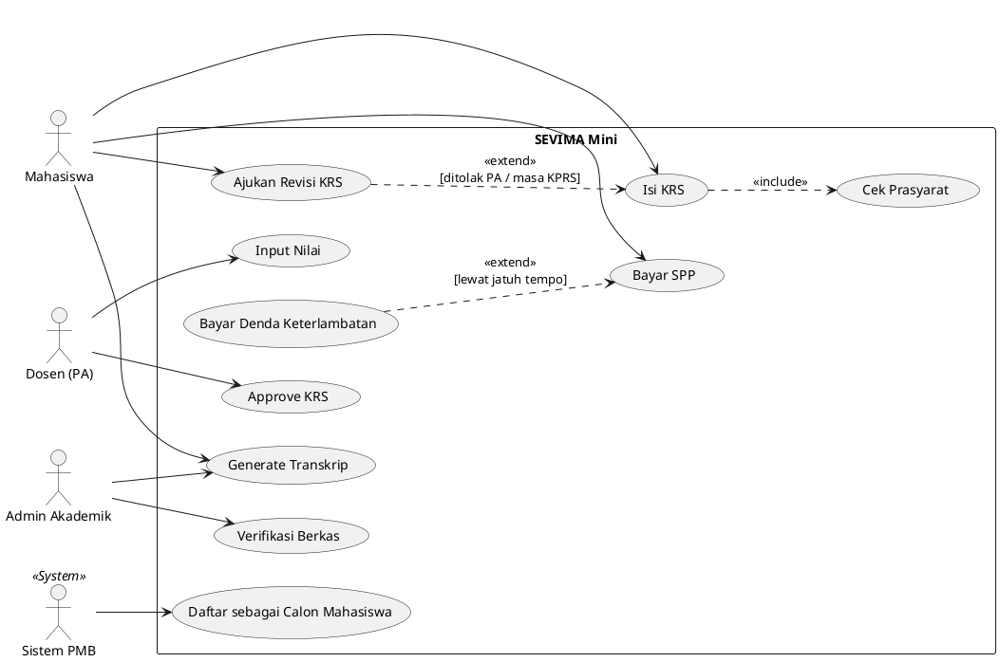

# Use Case Diagram - SEVIMA Mini (Versi 1)

Diagram use case UML untuk sistem informasi akademik kampus kecil **SEVIMA Mini** yang dirancang berdasarkan standar formal **UML 2.5** dan kaidah analisis sistem berorientasi objek (*Object-Oriented Analysis and Design*).

---

## 📌 Bukti Visual Diagram (Versi 1)

---

## 🛠️ Kode Sumber PlantUML

Kode sumber PlantUML tersimpan di [use-case-diagram.puml](use-case-diagram.puml):

---

## 🏛️ Spesifikasi Aktor & Batasan Tanggung Jawab

| Aktor | Tipe Aktor | Deskripsi Peran & Hak Akses | Asosiasi Use Case |
| :--- | :--- | :--- | :--- |
| **Mahasiswa** | *Primary (Human)* | Pengguna utama layanan akademik mandiri kampus. | `Bayar SPP`, `Isi KRS`, `Ajukan Revisi KRS`, `Generate Transkrip` |
| **Dosen (PA)** | *Primary (Human)* | Pembimbing akademik dan evaluator hasil belajar. | `Approve KRS`, `Input Nilai` |
| **Admin Akademik**| *Primary (Human)* | Pengelola tata usaha, verifikasi berkas, dan legalisasi data. | `Verifikasi Berkas`, `Generate Transkrip` |
| **Sistem PMB** | *External System (`<<System>>`)* | Sistem eksternal penerimaan calon mahasiswa baru yang terintegrasi via API/layanan data. | `Daftar sebagai Calon Mahasiswa` |

---

## 🔗 Analisis Formal Relasi `<<include>>` dan `<<extend>>`

### 1. Relasi `<<include>>`: `Isi KRS` $\longrightarrow$ `Cek Prasyarat`
- **Arah Panah:** Dari use case dasar (`Isi KRS`) menuju use case yang disertakan (`Cek Prasyarat`).
- **Semantik:** **Wajib (*Mandatory / Non-skippable*)**.
- **Logika Bisnis:**
  Setiap kali mahasiswa melakukan submit pemilihan mata kuliah pada use case `Isi KRS`, sistem **secara wajib dan otomatis** mengeksekusi sub-rutin `Cek Prasyarat`. Validasi ini memverifikasi pemenuhan mata kuliah prasyarat yang telah lulus (*prerequisite courses*), batas maksimal beban SKS berdasarkan capaian IPK semester sebelumnya (maksimal 24 SKS), serta pencegahan jadwal kuliah bentrok. Alur `Isi KRS` tidak dapat dianggap berhasil (*complete*) tanpa lolos verifikasi ini.

### 2. Relasi `<<extend>>`: `Bayar Denda Keterlambatan` $\longrightarrow$ `Bayar SPP`
- **Arah Panah:** Dari use case ekstensi (`Bayar Denda Keterlambatan`) menuju use case dasar (`Bayar SPP`).
- **Semantik:** **Tambahan Bersyarat (*Conditional Addition*)**.
- **Titik Perluasan (*Extension Point*):** `[lewat jatuh tempo]` (*Pembayaran dilakukan setelah batas akhir kalender akademik*).
- **Logika Bisnis:**
  Use case dasar mahasiswa adalah `Bayar SPP`. Use case `Bayar Denda Keterlambatan` hanya disisipkan jika tanggal pembayaran riil telah melampaui tanggal jatuh tempo tagihan (*due date*). Pada mahasiswa yang membayar tepat waktu (*happy path*), use case ekstensi ini tidak pernah dipanggil.

### 3. Relasi `<<extend>>`: `Ajukan Revisi KRS` $\longrightarrow$ `Isi KRS`
- **Arah Panah:** Dari use case ekstensi (`Ajukan Revisi KRS`) menuju use case dasar (`Isi KRS`).
- **Semantik:** **Tambahan Bersyarat (*Conditional Branch*)**.
- **Titik Perluasan (*Extension Point*):** `[ditolak PA / masa KPRS]` (*Rencana studi ditolak oleh Dosen PA atau mahasiswa mengajukan perubahan pada masa Batal-Tambah*).
- **Logika Bisnis:**
  `Isi KRS` adalah use case registrasi rencana studi awal semester. `Ajukan Revisi KRS` memperluas use case dasar tersebut saat terjadi kondisi khusus di mana KRS yang telah diajukan memerlukan perubahan (misalnya setelah sesi asistensi perwalian dengan Dosen PA yang menghasilkan catatan revisi/penolakan, atau mahasiswa ingin menukar kelas pada masa KPRS resmi).

---

## 💡 Keputusan Desain Analis Senior (*Architectural Decisions*)

1. **Pemisahan Pra-kondisi vs. Relasi Include (`Bayar SPP` terhadap `Isi KRS`):**
   - Menghubungkan `Isi KRS ..> Bayar SPP : <<include>>` adalah *anti-pattern* umum. Pembayaran SPP merupakan transaksi domain keuangan independen yang dilakukan di loket bank/gateway pembayaran pada rentang waktu sebelumnya (*temporal separation*). Status lunas SPP dicek sebagai *precondition* (atau bagian dari validasi status aktif pada `Cek Prasyarat`), bukan sub-langkah transaksi keuangan yang dieksekusi saat memilih mata kuliah.
2. **Asinkronitas `Daftar sebagai Calon Mahasiswa` dan `Verifikasi Berkas`:**
   - Proses pendaftaran dari `Sistem PMB` bersifat otomatis dan *real-time*, sedangkan `Verifikasi Berkas` oleh `Admin Akademik` berlangsung secara asinkron (*asynchronous administrative review*). Oleh karena itu, keduanya berdiri sebagai use case independen tanpa dependensi sinkron `<<include>>`.
