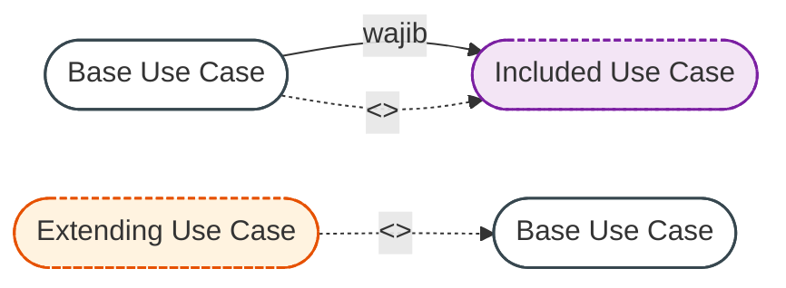

# ADR-002: Desain Use Case Sistem Informasi Akademik dan Relasi Include/Extend

* **Status:** Diterima (*Accepted*) - Direvisi v2.1
* **Tanggal:** 2026-11-01
* **Penyusun:** Arsitek Sistem (*System Architect*)
* **Konteks Sistem:** Platform Akademik Kampus (*Academic Information System / SEVIMA-Mini*)

---

## 1. Konteks & Latar Belakang (Context)

Sistem Informasi Akademik **SEVIMA-Mini** memerlukan dekomposisi fungsionalitas yang terstruktur, presisi, dan kohesif untuk memisahkan wewenang pengguna, otomasi proses bisnis kampus, serta integrasi subsistem admisi eksternal. Sistem melayani interaksi dari berbagai peran aktor civitas dan sistem:
1. `Calon Mahasiswa` (pendaftar baru yang mengikuti tahapan admisi)
2. `Mahasiswa` (civitas aktif yang melakukan kegiatan mandiri akademik dan administrasi)
3. `Dosen PA` (Pembimbing Akademik yang bertugas membina dan mengesahkan rencana studi mahasiswa)
4. `Dosen Pengajar` (tenaga pendidik yang mengampu perkuliahan, memasukkan nilai, dan menangani sanggahan)
5. `Admin` (administrator institusional yang mengelola data master kurikulum, jadwal, dan akun)
6. `Sistem PMB` (subsistem eksternal penerimaan mahasiswa baru yang terhubung via antarmuka sinkronisasi)

Tantangan pemodelan use case yang diatasi meliputi:
* **Inkonsistensi Asosiasi Aktor:** Pendaftaran mahasiswa baru (`Daftar Kuliah`) sebelumnya salah dikaitkan ke `Mahasiswa`, padahal pendaftar belum memiliki identitas civitas resmi. Aktor `Calon Mahasiswa` harus dipisahkan secara eksplisit.
* **Ambiguitas Peran Dosen:** Peran Dosen dipisahkan menjadi dua peran spesifik: `Dosen PA` (evaluasi KRS) dan `Dosen Pengajar` (input nilai, jadwal ajar, dan sanggah nilai) dengan istilah baku **Dosen PA** (menggantikan istilah Dosen Wali).
* **Koreksi Asosiasi Transkrip:** Use case `Generate Transkrip Nilai` sebelumnya salah dikaitkan ke Dosen; fungsi ini seharusnya diakses oleh `Mahasiswa` (melihat rekam jejak kumulatif) dan `Admin` (pencetakan dokumen resmi kelembagaan).
* **Penyempurnaan Relasi `<<extend>>`:** Sanggah nilai sebelumnya salah dimodelkan meng-extend `Input Nilai`. Alur yang benar adalah mahasiswa mengajukan sanggahan setelah meninjau lembar hasil studi (`Lihat KHS`), sehingga relasi diarahkan `UC_SanggahNilai -. "<<extend>>" .-> UC_LihatKHS`.
* **Sinkronisasi terhadap Sequence Flow:** Menambahkan use case yang muncul pada diagram sekuensial: autentikasi (`Login`), seleksi admisi (`Verifikasi Berkas & Seleksi`), penomoran (`Generate NIM`), multi-validasi rencana studi (`Validasi Batas Beban SKS`, `Validasi Bentrok Jadwal`, `Validasi Duplikasi Mata Kuliah`), monitoring jadwal (`Lihat Jadwal Kuliah`), dan notifikasi instan (`Kirim Notifikasi Real-time`).

---

## 2. Keputusan Arsitektur & Dekomposisi Use Case (Architectural Decision)

### 2.1 Identifikasi Aktor & Batasan Sistem

Sistem membedakan peran aktor primer (*human actors*) dan sistem eksternal (*system actors*):
* **`Calon Mahasiswa`**: Aktor pendaftar yang mengakses portal admisi untuk menginput formulir registrasi dan mengunggah dokumen persyaratan.
* **`Mahasiswa`**: Mahasiswa aktif yang melakukan pembayaran biaya kuliah, pengisian KRS, melihat jadwal kuliah, melihat KHS, mengajukan sanggah nilai, dan mengunduh transkrip akademik.
* **`Dosen PA` (Pembimbing Akademik)**: Bertanggung jawab membina mahasiswa bimbingan serta meninjau, menyetujui, atau menolak pengajuan rencana studi (KRS) dengan catatan evaluasi.
* **`Dosen Pengajar`**: Bertanggung jawab memonitor jadwal perkuliahan yang diampu, memasukkan komponen nilai mahasiswa, dan memproses sanggahan nilai dari mahasiswa.
* **`Admin` (Administrator Sistem)**: Mengelola verifikasi berkas dan seleksi PMB, sinkronisasi data admisi, penerbitan transkrip resmi institusi, kurikulum mata kuliah, alokasi jadwal ruang/waktu, dan master data pengguna.
* **`Sistem PMB` (Sistem Eksternal)**: Subsistem admisi yang berintegrasi dengan SEVIMA-Mini untuk pertukaran data formulir dan pemicuan proses sinkronisasi pendaftar yang lolos seleksi.

---

### 2.2 Dekomposisi Modul & Matriks Use Case

| Modul Fungsional | Use Case | Tipe Use Case | Aktor Terkait | Deskripsi Fungsional |
| :--- | :--- | :--- | :--- | :--- |
| **Autentikasi & Akun** | `Autentikasi / Login` | Base Use Case | `Mahasiswa`, `Dosen PA`, `Dosen Pengajar`, `Admin` | Verifikasi kredensial civitas dan manajemen token sesi. |
| **Registrasi & Admisi (PMB)** | `Daftar Kuliah` | Base Use Case | `Calon Mahasiswa`, `Sistem PMB` | Registrasi formulir pendaftar dan pemilihan program studi. |
| | `Unggah Berkas Persyaratan` | Included Use Case | - (`<<include>>` dari `Daftar Kuliah`) | Upload dokumen legalitas pendaftar (Ijazah, SKL, KTP). |
| | `Verifikasi Berkas & Seleksi` | Base Use Case | `Admin` | Verifikasi dokumen legalitas dan penetapan status kelulusan. |
| | `Sinkronisasi Data Mahasiswa` | Base Use Case | `Admin`, `Sistem PMB` | Migrasi pendaftar lolos seleksi menjadi civitas aktif. |
| | `Generate NIM Mahasiswa Baru` | Included Use Case | - (`<<include>>` dari `Sinkronisasi Data Mahasiswa`) | Penomoran NIM otomatis berbasis kode prodi dan tahun masuk. |
| **Keuangan** | `Bayar Biaya Kuliah` | Base Use Case | `Mahasiswa` | Pembayaran tagihan semester berjalan (SPP/UKT). |
| | `Ajukan Keringanan / Cicilan` | Extended Use Case | - (`<<extend>>` ke `Bayar Biaya Kuliah`) | Pengajuan dispensasi termin atau penundaan pembayaran. |
| | `Validasi Status Pembayaran` | Included Use Case | - (`<<include>>` dari `Isi KRS`) | Gerbang validasi pelunasan tagihan sebelum KRS dibuka. |
| **Rencana Studi (KRS)** | `Isi KRS` | Base Use Case | `Mahasiswa` | Pemilihan paket mata kuliah pada semester aktif. |
| | `Validasi Prasyarat Mata Kuliah` | Included Use Case | - (`<<include>>` dari `Isi KRS`) | Pengecekan kelulusan mata kuliah prasyarat akademik. |
| | `Validasi Batas Beban SKS` | Included Use Case | - (`<<include>>` dari `Isi KRS`) | Pengecekan kuota maksimal beban SKS (maksimum 24 SKS). |
| | `Validasi Bentrok Jadwal` | Included Use Case | - (`<<include>>` dari `Isi KRS`) | Deteksi tumpang-tindih hari dan jam perkuliahan. |
| | `Validasi Duplikasi Mata Kuliah` | Included Use Case | - (`<<include>>` dari `Isi KRS`) | Pencegahan pendaftaran mata kuliah ganda dalam satu KRS. |
| | `Revisi / Batal-Tambah KRS` | Extended Use Case | - (`<<extend>>` ke `Isi KRS`) | Perubahan komposisi mata kuliah pada masa revisi (Drop/Add). |
| | `Cetak Bukti KRS` | Extended Use Case | - (`<<extend>>` ke `Isi KRS`) | Pencetakan lembar rencana studi resmi mahasiswa. |
| | `Validasi & Persetujuan KRS` | Base Use Case | `Dosen PA` | Tinjauan komposisi mata kuliah dan persetujuan KRS. |
| | `Tolak KRS dengan Catatan` | Extended Use Case | - (`<<extend>>` ke `Validasi & Persetujuan KRS`) | Penolakan draft KRS oleh Dosen PA disertai revisi bimbingan. |
| **Penilaian & Hasil Studi** | `Input Nilai Mahasiswa` | Base Use Case | `Dosen Pengajar` | Penginputan skor tugas, UTS, UAS per kelas kuliah. |
| | `Kalkulasi Nilai Akhir & Mutu` | Included Use Case | - (`<<include>>` dari `Input Nilai Mahasiswa`) | Komputasi pembobotan skor dan konversi huruf mutu (A-E). |
| | `Lihat Kartu Hasil Studi (KHS)`| Base Use Case | `Mahasiswa` | Monitoring indeks prestasi semester (IPS) berjalan. |
| | `Proses Sanggah Nilai` | Extended Use Case | `Mahasiswa`, `Dosen Pengajar` (`<<extend>>` ke `Lihat KHS`) | Pengajuan klarifikasi nilai oleh mahasiswa dalam masa sanggah. |
| | `Generate Transkrip Nilai` | Base Use Case | `Mahasiswa`, `Admin` | Penerbitan rekam jejak akademik kumulatif civitas. |
| | `Kalkulasi IPK & SKS Kumulatif` | Included Use Case | - (`<<include>>` dari `Generate Transkrip Nilai`) | Komputasi total SKS lulus dan Indeks Prestasi Kumulatif. |
| | `Export Transkrip Resmi (PDF)` | Extended Use Case | - (`<<extend>>` ke `Generate Transkrip Nilai`) | Ekspor transkrip bertandatangan digital resmi institusi. |
| **Administrasi & Master** | `Lihat Jadwal Kuliah` | Base Use Case | `Mahasiswa`, `Dosen Pengajar` | Akses jadwal perkuliahan mingguan dan alokasi ruang. |
| | `Kelola Kurikulum & Mata Kuliah` | Base Use Case | `Admin` | Konfigurasi mata kuliah, bobot SKS, dan relasi prasyarat. |
| | `Kelola Alokasi Jadwal` | Base Use Case | `Admin` | Pengaturan jadwal hari, sesi jam, ruangan, dan kuota kelas. |
| | `Kelola Data Pengguna` | Base Use Case | `Admin` | Manajemen akun dan perwalian civitas akademika. |
| **Layanan Pendukung** | `Kirim Notifikasi Real-time` | Included Use Case | - (`<<include>>` dari `Approve KRS` & `Tolak KRS`) | Layanan notifikasi perubahan status dokumen akademik. |

---

### 2.3 Keputusan Penggunaan Relasi `<<include>>` vs `<<extend>>`

Pemodelan mematuhi standar UML 2.5 secara ketat:
* **`<<include>>`** menandakan fragmen fungsional wajib (*mandatory execution*) yang selalu dieksekusi saat base use case berjalan. Panah mengarah dari Base Use Case ke Included Use Case (`Base -. "<<include>>" .-> Included`).
* **`<<extend>>`** menandakan alur opsional atau kondisional (*optional/conditional execution*) yang hanya dieksekusi pada *extension point* tertentu jika syarat terpenuhi. Panah mengarah dari Extending Use Case ke Base Use Case (`Extending -. "<<extend>>" .-> Base`).

#### A. Rationale Relasi `<<include>>` (Mandatory Sub-flows)
1. **`Daftar Kuliah` $\rightarrow$ `Unggah Berkas Persyaratan`**:
   * **Rationale:** Pendaftaran mahasiswa baru wajib menyertakan dokumen digital legalitas (Ijazah, SKL, KTP) sebagai bukti verifikasi keabsahan data.
2. **`Sinkronisasi Data Mahasiswa` $\rightarrow$ `Generate NIM Mahasiswa Baru`**:
   * **Rationale:** Proses migrasi calon mahasiswa menjadi civitas resmi secara wajib menghasilkan NIM unik institusional terenkapsulasi via komponen `NIMGenerator`.
3. **`Isi KRS` $\rightarrow$ Multi-Rule Validation (5 Aturan Strategi)**:
   * **`Validasi Status Pembayaran`**: Gerbang utama finansial; mahasiswa wajib lunas SPP sebelum rencana studi dapat diajukan.
   * **`Validasi Prasyarat Mata Kuliah`**: Verifikasi kepatuhan kelulusan mata kuliah prasyarat pada semester sebelumnya.
   * **`Validasi Batas Beban SKS`**: Verifikasi bahwa total SKS yang diambil tidak melampaui batas maksimal (maksimum 24 SKS).
   * **`Validasi Bentrok Jadwal`**: Verifikasi tidak adanya benturan hari dan jam perkuliahan antar-kelas terpilih.
   * **`Validasi Duplikasi Mata Kuliah`**: Verifikasi pencegahan pengambilan mata kuliah yang sama lebih dari satu kali dalam semester aktif.
4. **`Input Nilai Mahasiswa` $\rightarrow$ `Kalkulasi Nilai Akhir & Mutu`**:
   * **Rationale:** Pengisian skor komponen (tugas, UTS, UAS) secara inheren menghitung nilai akhir terbobot dan mengonversinya menjadi huruf mutu (A-E) via evaluator mutu.
5. **`Generate Transkrip Nilai` $\rightarrow$ `Kalkulasi IPK & SKS Kumulatif`**:
   * **Rationale:** Penerbitan transkrip akademik secara mutlak membutuhkan kalkulasi agregasi total SKS lulus dan nilai IPK kumulatif.
6. **`Validasi & Persetujuan KRS` & `Tolak KRS` $\rightarrow$ `Kirim Notifikasi Real-time`**:
   * **Rationale:** Setiap keputusan Dosen PA (disetujui maupun ditolak) wajib memicu diseminasi notifikasi instan kepada mahasiswa bersangkutan.

#### B. Rationale Relasi `<<extend>>` (Conditional / Extension Points)
1. **`Ajukan Keringanan / Cicilan` $\rightarrow$ `Bayar Biaya Kuliah`**:
   * **Extension Point:** Kondisional saat mahasiswa mengalami kendala finansial dan mengajukan permohonan dispensasi pembayaran sebelum tenggat waktu.
2. **`Revisi / Batal-Tambah KRS` $\rightarrow$ `Isi KRS`**:
   * **Extension Point:** Aktif kondisional hanya pada periode kalender akademik revisi rencana studi (*Drop/Add period*).
3. **`Cetak Bukti KRS` $\rightarrow$ `Isi KRS`**:
   * **Extension Point:** Opsional saat mahasiswa membutuhkan salinan cetak/PDF rencana studi setelah proses submit berhasil.
4. **`Tolak KRS dengan Catatan` $\rightarrow$ `Validasi & Persetujuan KRS`**:
   * **Extension Point:** Terpicu kondisional jika Dosen PA menilai komposisi rencana studi tidak layak dan memerlukan revisi mahasiswa.
5. **`Proses Sanggah Nilai` $\rightarrow$ `Lihat Kartu Hasil Studi (KHS)`**:
   * **Extension Point:** Terpicu kondisional saat mahasiswa menemukan ketidaksesuaian skor pada lembar KHS selama jendela masa sanggah dibuka. Melibatkan aktor `Mahasiswa` (pengaju) dan `Dosen Pengajar` (evaluator).
6. **`Export Transkrip Resmi (PDF)` $\rightarrow$ `Generate Transkrip Nilai`**:
   * **Extension Point:** Opsional saat dibutuhkan dokumen transkrip resmi bertandatangan digital institusi untuk keperluan beasiswa atau kelulusan.

---

## 3. Pertimbangan Desain & Analisis Trade-off (Consequences)

### 3.1 Pemisahan Aktor `Calon Mahasiswa` vs `Mahasiswa`
* **Kelebihan:** Mencegah kebocoran hak akses (*privilege escalation*); calon mahasiswa tidak dapat mengakses fitur internal akademik (KRS, KHS, Jadwal) sebelum resmi berstatus mahasiswa aktif dan memiliki NIM resmi.
* **Trade-off:** Menambah entitas aktor pada model use case; dimitigasi dengan pengelompokan modular yang rapi pada diagram.

### 3.2 Granularitas Relasi `<<include>>` pada Evaluasi KRS
* **Kelebihan:** Setiap aturan validasi rencana studi dipetakan secara jelas ke use case mikro, selaras dengan penerapan *Strategy Pattern* (`ValidationRule`) pada arsitektur class diagram dan sequence flow.
* **Trade-off:** Menambah kerapatan relasi pada diagram use case; diatasi dengan pembungkusan subgraph (*Modul Rencana Studi*).

### 3.3 Penataan Ulang Sanggah Nilai ke `Lihat KHS`
* **Kelebihan:** Merefleksikan alur *User Experience (UX)* dunia nyata: mahasiswa tidak menyanggah saat dosen mengetik nilai, melainkan setelah mahasiswa melihat publikasi nilai pada KHS mereka.
* **Trade-off:** Memerlukan asosiasi ganda pada use case sanggah nilai (`Mahasiswa` sebagai pengaju dan `Dosen Pengajar` sebagai penerima sanggahan).

---

## 4. Referensi Berkas Terkait

* Diagram UML Use Case Mermaid: [`diagrams/usecase-diagram.mmd`](file:///home/zainun/Git/istn/sevima-mini/diagrams/usecase-diagram.mmd)
* Diagram Class Domain: [`diagrams/class-diagram.mmd`](file:///home/zainun/Git/istn/sevima-mini/diagrams/class-diagram.mmd)
* Diagram Sequence PMB: [`diagrams/sequence-pmb.mmd`](file:///home/zainun/Git/istn/sevima-mini/diagrams/sequence-pmb.mmd)
* Diagram Sequence KRS: [`diagrams/sequence-krs.mmd`](file:///home/zainun/Git/istn/sevima-mini/diagrams/sequence-krs.mmd)
