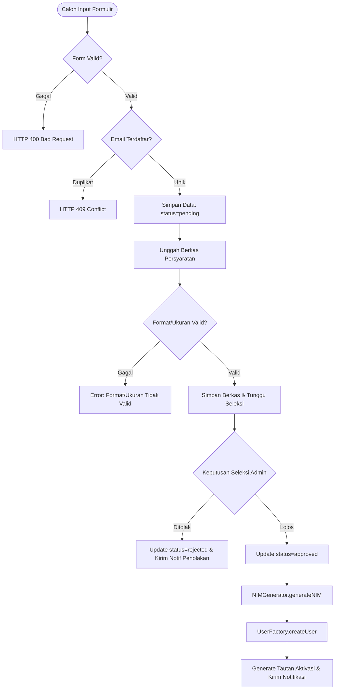

# ADR-003: Desain Sequence Diagram PMB dan Validasi KRS Bertingkat Berbasis Strategy Pattern & Proteksi Konkurensi

* **Status:** Diterima (*Accepted*) - Direvisi v2.1
* **Tanggal:** 2026-11-01
* **Penyusun:** Arsitek Sistem (*System Architect*)
* **Konteks Sistem:** Platform Akademik Kampus (*Academic Information System / SEVIMA-Mini*)

---

## 1. Konteks & Latar Belakang (Context)

Dalam platform akademik **SEVIMA-Mini**, proses transaksi data memiliki dua titik kritis (*critical path*) dengan risiko integritas data, keamanan, dan beban konkurensi tertinggi:
1. **Transisi Status Calon Mahasiswa (PMB):** Siklus migrasi entitas pendaftar (`CalonMahasiswa`) menjadi civitas resmi (`Mahasiswa`), melibatkan verifikasi dokumen legalitas, mitigasi pendaftaran ganda, penetapan kelulusan, pembentukan Nomor Induk Mahasiswa (NIM) resmi, dan pengamanan kredensial aktivasi.
2. **Validasi Pengajuan Rencana Studi (KRS):** Transaksi registrasi perkuliahan saat beban puncak (*War KRS*) yang melibatkan validasi finansial, pengecekan prasyarat kurikulum, pembatasan beban SKS, deteksi bentrok jadwal, pencegahan duplikasi pendaftaran, alokasi kapasitas kelas yang aman dari *race condition*, serta ruang lingkup transaksi database ACID.

Tantangan arsitektur yang diselesaikan pada revisi ini meliputi:
* **Mitigasi Race Condition / TOCTOU pada Kapasitas Kelas:** Pengecekan ketersediaan kursi yang terpisah dari pengurangan kuota rentan mengalami *overbooking* saat ribuan mahasiswa berebut kelas secara bersamaan. Diperlukan mekanisme reservasi kapasitas atomik (`reserveKapasitas()`) dan kompensasi pembatalan (`releaseKapasitas()`).
* **Pemisahan Tanggung Jawab Penomoran NIM (SRP):** Logika algoritma format NIM sebelumnya membebani `UserFactory`. Sesuai prinsip *Single Responsibility*, pembentukan NIM dipisahkan ke dalam komponen mandiri `NIMGenerator`.
* **Keamanan Kredensial Pengguna Baru:** Menghilangkan pengiriman kata sandi polos (*plaintext password*) melalui kanal komunikasi tidak terenkripsi, digantikan dengan penerbitan tautan aktivasi mandiri bertoken aman (*activation link*).
* **Modularitas Aturan Validasi Rencana Studi:** Mengganti validasi monolitik dengan *Strategy Pattern* (`ValidationRule`) yang menaungi 5 aturan independen.
* **Penanganan Alur Alternatif & Kegagalan Sistem:** Mendokumentasikan secara komprehensif alur penolakan, bentrok, kapasitas penuh, dan kegagalan database (*DatabaseException*) dengan transaksi kompensasi dan rollback.
* **Pemisahan Siklus Persetujuan Dosen PA:** Memisahkan alur pengajuan KRS oleh mahasiswa dari proses peninjauan persetujuan oleh Dosen PA ke dalam sesi asinkron terpisah (*decoupled lifecycle*).

---

## 2. Keputusan Arsitektur & Interaksi Objek (Architectural Decision)

### 2.1 Alur 1: Pendaftaran Mahasiswa Baru (PMB) v2.1

Alur sekuensial PMB dimodelkan ke dalam empat tahapan berurutan beserta empat alur alternatif (*alternate flows*):



#### Rincian 4 Tahapan PMB:
1. **Tahap 1: Registrasi Akun & Pengisian Formulir:**
   * Calon mahasiswa memasukkan identitas diri, prodi tujuan, dan jalur masuk melalui `Portal PMB`.
   * **Alt Flow 1 (HTTP 400 Bad Request):** Jika formulir tidak lengkap atau format data salah, sistem menolak pengajuan dan menampilkan pesan error.
   * `PMBService` memverifikasi keunikan email calon mahasiswa ke database.
   * **Alt Flow 2 (HTTP 409 Conflict):** Jika email telah terdaftar sebelumnya, sistem mengembalikan kode HTTP 409 dan mengarahkan pengguna ke opsi pemulihan akun/login.
   * Jika email unik, data disimpan dengan status `"pending"` dan nomor pendaftaran resmi diterbitkan.
2. **Tahap 2: Unggah Berkas Persyaratan & Validasi Dokumen:**
   * Calon mahasiswa mengunggah dokumen persyaratan (Ijazah, SKL, KTP) dengan batas maksimal 2MB (format PDF/JPG).
   * **Alt Flow 3 (Berkas Tidak Valid):** Jika format atau ukuran file melanggar standar, `PMBService` menolak unggahan dan menginstruksikan pengunggahan ulang.
   * Berkas yang valid disimpan ke `Storage`, tautan path disimpan ke database, dan status tetap `"pending"`.
3. **Tahap 3: Verifikasi Berkas & Keputusan Seleksi Masuk:**
   * Admin Admisi membuka antrean seleksi berkas berstatus `"pending"`.
   * **Alt Flow 4 (Calon Ditolak / Tidak Lulus):** Jika berkas atau nilai tidak memenuhi syarat, Admin menginput penolakan. Status diubah menjadi `"rejected"` dan sistem mengirimkan notifikasi resmi penolakan via `NotificationService`. Alur berakhir tanpa pembuatan akun.
   * **Normal Flow (Calon Lulus Seleksi):** Admin mengesahkan kelulusan, dan status diperbarui menjadi `"approved"`.
4. **Tahap 4: Sinkronisasi, Pembuatan Akun & Tautan Aktivasi Mandiri:**
   * `PMBService` memanggil `NIMGenerator.generateNIM(prodi, tahunMasuk)` untuk memproduksi NIM resmi (mematuhi prinsip SRP).
   * `UserFactory.createUser("Mahasiswa", dataCalonWithNIM)` dipanggil untuk menginstansiasi objek `Mahasiswa` baru.
   * Menggantikan pengiriman password teks polos, `PMBService` membuat tautan aktivasi unik (`tautanAktivasi`) dan mengirimkannya bersama NIM resmi via `NotificationService`. Mahasiswa menyelesaikan pembuatan password secara mandiri melalui tautan tersebut.

---

### 2.2 Alur 2: Pengajuan & Validasi KRS dengan Proteksi Konkurensi v2.1

Alur sekuensial KRS dirancang menggunakan arsitektur *fail-fast*, *strategy pattern*, dan *concurrency locking*:

```
[Mhs Submit KRS] 
       │
       ▼
[Tahap 1: Validasi Masa KRS] ──────────(Tutup)─────────► [Alt Flow 1: Periode KRS Ditutup]
       │ (Aktif)
       ▼
[Tahap 2: PaymentValidationRule] ──────(Belum Lunas)───► [Alt Flow 2: Tagihan SPP Belum Lunas]
       │ (Lunas)
       ▼
[Tahap 3: Schedule.reserveKapasitas()] ──(Penuh)────────► [Alt Flow 3: releaseKapasitas() & Tolak]
       │ (Tersedia)
       ▼
[Tahap 4: Multi-Rule Strategy Execution]
 ├── PrerequisiteRule ────────────────(Gagal)─────────► [Alt Flow 4a: releaseKapasitas() & Tolak]
 ├── SksLimitRule (<= 24) ────────────(Gagal)─────────► [Alt Flow 4b: releaseKapasitas() & Tolak]
 ├── ScheduleConflictRule ────────────(Gagal)─────────► [Alt Flow 4c: releaseKapasitas() & Tolak]
 └── DoubleEnrollmentRule ────────────(Gagal)─────────► [Alt Flow 4d: releaseKapasitas() & Tolak]
       │ (Semua Rule Lolos)
       ▼
[Tahap 5: Penetapan Status: PENDING_APPROVAL]
       │
       ▼
[Tahap 6: Transaction Scope DB] ───────(DB Fail)───────► [Alt Flow 5: Rollback DB & releaseKapasitas()]
       │ (Commit Sukses)
       ▼
[Tahap 7: Notifikasi Terpusat ke Dosen PA]
       │
══════════════════════════════════════════════════════════════════════════════════════
 SESI ASINKRON TERPISAH (Waktu Berbeda): Evaluasi & Keputusan Dosen PA
══════════════════════════════════════════════════════════════════════════════════════
       │
       ├─── Dosen PA Setuju (Approve) ──► status = "APPROVED" ──► Notifikasi Mahasiswa
       │
       └─── Dosen PA Tolak / Revisi ───► status = "REVISED/REJECTED" ──► releaseKapasitas() ──► Notifikasi
```

#### Rincian 7 Tahapan KRS + Sesi Asinkron Dosen PA:
1. **Tahap 1: Pengajuan KRS & Pengecekan Periode Kalender Akademik:**
   * Mahasiswa mengajukan rencana studi melalui `Portal KRS`.
   * **Alt Flow 1 (Masa KRS Ditutup):** Jika jadwal kalender akademik semester aktif telah berakhir, sistem menolak seketika (*fail-fast*).
2. **Tahap 2: Pengecekan Syarat Finansial (`PaymentValidationRule`):**
   * Service memvalidasi tagihan SPP semester aktif.
   * **Alt Flow 2 (SPP Belum Lunas):** Jika belum lunas dan tidak memiliki dispensasi, KRS terkunci dan instruksi pelunasan ditampilkan.
3. **Tahap 3: Reservasi Atomik Kuota Kapasitas Kelas (`reserveKapasitas()`):**
   * Menghindari *race condition* pada saat ribuan mahasiswa mendaftar serentak, sistem mengunci slot kuota secara atomik pada entitas `Schedule`.
   * **Alt Flow 3 (Kapasitas Penuh):** Jika slot kelas habis, sistem membatalkan reservasi kelas-kelas sebelumnya dengan aksi kompensasi `Schedule.releaseKapasitas()`, lalu mengembalikan error ke mahasiswa.
4. **Tahap 4: Eksekusi Multi-Rule Validasi KRS (Strategy Pattern):**
   * Sistem mengevaluasi `List<ValidationRule>` secara berurutan:
     * **Alt Flow 4a (`PrerequisiteRule` Gagal):** Ditolak jika prasyarat mata kuliah kurikulum belum lulus.
     * **Alt Flow 4b (`SksLimitRule` Gagal):** Ditolak jika akumulasi beban SKS melebihi batas ketentuan (&gt; 24 SKS).
     * **Alt Flow 4c (`ScheduleConflictRule` Gagal):** Ditolak jika terdeteksi tumpang-tindih hari dan jam perkuliahan antar-kelas terpilih.
     * **Alt Flow 4d (`DoubleEnrollmentRule` Gagal):** Ditolak jika terdapat mata kuliah ganda dalam satu KRS.
     * *Aksi Kompensasi Universal:* Jika ada rule yang gagal, seluruh slot kelas yang sempat direservasi langsung dibatalkan melalui pemanggilan `Schedule.releaseKapasitas()`.
5. **Tahap 5: Pembentukan Rencana Studi & Penetapan Status:**
   * Mahasiswa mendapatkan status pendaftaran awal `"PENDING_APPROVAL"`, dan total SKS dihitung otomatis.
6. **Tahap 6: Persistensi Data dengan Ruang Lingkup Transaksi (*Transaction Scope*):**
   * Operasi penyimpanan dibungkus transaksi ACID: `DB.beginTransaction()`.
   * **Alt Flow 5 (Error Database / Timeout):** Jika terjadi `DatabaseException`, sistem mengeksekusi `DB.rollbackTransaction()` dan memanggil transaksi kompensasi `Schedule.releaseKapasitas()` agar kuota kelas kembali utuh.
   * Jika sukses, data di-commit resmi melalui `DB.commitTransaction()`.
7. **Tahap 7: Notifikasi Terpusat ke Dosen PA:**
   * `KRSService` memicu `NotificationService.broadcastKRSUpdate()` untuk memberitahu Dosen PA bahwa terdapat pengajuan rencana studi baru yang menunggu evaluasi.
8. **Sesi Asinkron Terpisah: Evaluasi & Keputusan Dosen PA:**
   * Dosen PA membuka portal pada waktu terpisah dan meninjau rencana studi mahasiswa.
   * **Opsi Persetujuan (Approve):** Status diperbarui menjadi `"APPROVED"`, dan mahasiswa menerima notifikasi real-time bahwa KRS telah resmi aktif.
   * **Opsi Penolakan/Revisi (Reject):** Status disetel menjadi `"REVISED / REJECTED"` disertai catatan bimbingan, sistem melepaskan kuota kelas via `Schedule.releaseKapasitas()`, dan mahasiswa menerima notifikasi untuk menyusun ulang rencana studi.

---

## 3. Pertimbangan Desain & Pola Arsitektur Enterprise (Patterns & Trade-offs)

### 3.1 Pemisahan `NIMGenerator` dari `UserFactory` (Prinsip SRP)
* **Kelebihan:** Logika algoritma pembentukan format penomoran NIM (`[KodeProdi][TahunMasuk][NomorUrut]`) terisolasi secara kohesif, memudahkan perubahan format penomoran di masa depan tanpa mengubah kode instansiasi objek `UserFactory`.
* **Trade-off:** Menambah satu dependensi komponen layanan; dimitigasi dengan injeksi dependensi sederhana.

### 3.2 Tautan Aktivasi vs Plaintext Password (Keamanan Kredensial)
* **Kelebihan:** Meniadakan risiko kebocoran kata sandi awal pada log server, email perantara, atau penyadapan jaringan. Calon mahasiswa memegang otoritas penuh atas pembuatan kata sandi pertama kali.
* **Trade-off:** Memerlukan mekanisme penyimpanan token aktivasi bertenggat waktu (*expiring token*) di basis data.

### 3.3 Reservasi Kapasitas Atomik & Transaksi Kompensasi
* **Kelebihan:** Menjamin integritas data kuota kelas 100% akurat bebas dari *over-enrollment* saat perang KRS (*War KRS*), tanpa memerlukan *table lock* yang membebani performa database.
* **Trade-off:** Memerlukan logika kompensasi (*saga pattern*) `Schedule.releaseKapasitas()` pada setiap titik kegagalan (*rollback path*).

### 3.4 Decoupled Async Approval Lifecycle
* **Kelebihan:** Mencegah terjadinya *long-polling* atau *blocking HTTP request* pada aplikasi web mahasiswa saat menunggu respon manusia (Dosen PA).
* **Trade-off:** Mahasiswa harus memantau status secara asinkron atau melalui notifikasi push/email.

---

## 4. Referensi Berkas Terkait

* Diagram Sequence PMB Mermaid: [`diagrams/sequence-pmb.mmd`](file:///home/zainun/Git/istn/sevima-mini/diagrams/sequence-pmb.mmd)
* Diagram Sequence KRS Mermaid: [`diagrams/sequence-krs.mmd`](file:///home/zainun/Git/istn/sevima-mini/diagrams/sequence-krs.mmd)
* Diagram Class Domain: [`diagrams/class-diagram.mmd`](file:///home/zainun/Git/istn/sevima-mini/diagrams/class-diagram.mmd)
* Diagram UML Use Case: [`diagrams/usecase-diagram.mmd`](file:///home/zainun/Git/istn/sevima-mini/diagrams/usecase-diagram.mmd)
* Panduan Sequence Lengkap: [`docs/sequence/SEQUENCE-001-pmb-and-krs.md`](file:///home/zainun/Git/istn/sevima-mini/docs/sequence/SEQUENCE-001-pmb-and-krs.md)
