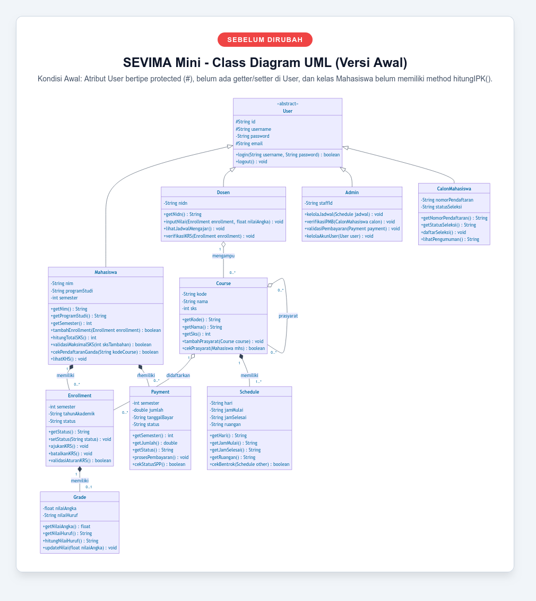
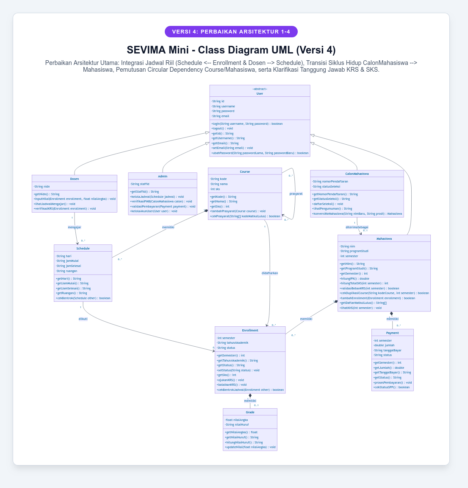

# Dokumentasi Riwayat Perbaikan Class Diagram UML - SEVIMA Mini

Dokumen ini mencatat bukti visual dan perbandingan evolusi class diagram UML sistem informasi akademik **SEVIMA Mini** dari Versi 1 hingga Versi 4.

---

## 1. Versi 1: Versi Awal

- **Karakteristik:**
  - Menggunakan visibility `protected (#)` pada atribut `User` (`id`, `username`, `email`).
  - Belum memiliki accessor publik (`getId()`, `getUsername()`, dll) pada `User`.
  - Belum memiliki method penghitungan IPK (`hitungIPK()`) pada `Mahasiswa`.
  - Menggunakan agregasi (`o--`) untuk relasi non-komposisi.

---

## 2. Versi 2: Enkapsulasi Penuh & Penambahan `hitungIPK()`

- **Perubahan Utama:**
  - Enkapsulasi ketat: seluruh atribut dijadikan `private (-)`.
  - Penambahan method publik accessor/mutator pada `User`, `Admin`, `Enrollment`, dan `Payment`.
  - Penambahan method khusus `+hitungIPK() double` pada kelas `Mahasiswa` (bukan di `User`).
  - Pembatasan jumlah method tetap $\le 9$ (SRP compliant).

---

## 3. Versi 3: Refactoring Relasi (Hasil Uji Wadah & Is-A)

- **Perubahan Utama:**
  - **Uji Wadah-Bagian (*Lifecycle Dependency*):**
    - `Course` $\rightarrow$ `Enrollment`: Diubah dari Agregasi (`o--`) menjadi **Asosiasi (`-->`)**, karena `Course` katalog bukan wadah dari transaksi pendaftaran `Enrollment`.
    - `Dosen` $\rightarrow$ `Course`: Diubah dari Agregasi (`o--`) menjadi **Asosiasi (`-->`)**, karena relasi murni peran mengajar.
    - `Course` $\rightarrow$ `Course` (Prasyarat): Diubah dari Agregasi (`o--`) menjadi **Asosiasi (`-->`)** antar sesama entitas mata kuliah setara (*self-referencing association*).
  - **Koreksi Kardinalitas:**
    - `Course "1" *-- "0..*" Schedule`: Batas minimum jadwal diubah dari `1..*` menjadi `0..*`.

---

## 4. Versi 4: Perbaikan Arsitektur Kritis 1-4

- **Perubahan Utama:**
  1. **Integrasi Jadwal Riil (Mengatasi Masalah 1):**
     - Menghubungkan `Schedule "1" --> "0..*" Enrollment : diikuti` agar mahasiswa terdaftar pada sesi/ruangan spesifik, memungkinkan pengecekan bentrok jadwal riil via `Enrollment.cekBentrokJadwal()`.
     - Menghubungkan `Dosen "1" --> "0..*" Schedule : mengajar` agar fungsionalitas `Dosen.lihatJadwalMengajar()` memiliki sumber data jam dan ruangan yang valid.
  2. **Transisi Siklus Hidup PMB (Mengatasi Masalah 2):**
     - Menambahkan method `CalonMahasiswa.konversiKeMahasiswa(nimBaru, prodi): Mahasiswa`.
     - Menambahkan relasi asosiasi transisi peran `CalonMahasiswa "1" --> "0..1" Mahasiswa : diterimaSebagai`.
  3. **Pemutusan Ketergantungan Siklik (Mengatasi Masalah 3):**
     - Mengubah signature `Course.cekPrasyarat(Mahasiswa mhs)` menjadi `Course.cekPrasyarat(String[] kodeMatkulLulus): boolean`.
     - Menghapus ketergantungan langsung `Course` terhadap `Mahasiswa`, sehingga kurikulum independen dari model mahasiswa.
  4. **Klarifikasi Tanggung Jawab KRS & SKS (Mengatasi Masalah 4):**
     - Menambahkan delegasi `Enrollment.getSks(): int`.
     - Menjadikan validasi batas 24 SKS dan duplikasi matkul berbasis semester spesifik pada `Mahasiswa` (`validasiBebanKRS(int semester)`, `cekDuplikasiCourse(kodeCourse, semester)`).

---

## Tabel Komparasi Riwayat Versi

| Evaluasi Arsitektural | Versi 1 | Versi 2 | Versi 3 | Versi 4 (Final Refactor) |
| :--- | :--- | :--- | :--- | :--- |
| **Enkapsulasi Atribut** | `protected (#)` | `private (-)` | `private (-)` | `private (-)` |
| **Method `hitungIPK()`** | Tidak ada | Ada di `Mahasiswa` | Ada di `Mahasiswa` | Ada di `Mahasiswa` |
| **Keterhubungan `Schedule`** | Hanya ke `Course` | Hanya ke `Course` | Hanya ke `Course` | **Terhubung ke `Enrollment` & `Dosen`** |
| **Siklus Hidup PMB** | Subclass kaku | Subclass kaku | Subclass kaku | **Asosiasi & Method Konversi ke `Mahasiswa`** |
| **Coupling `Course`-`Mahasiswa`**| Siklik (Course butuh Mahasiswa) | Siklik | Siklik | **Terputus (Course hanya butuh `String[]`)** |
| **Tanggung Jawab KRS** | Ambigu | Ambigu | Ambigu | **SKS didelegasikan, validasi semester terstruktur** |
