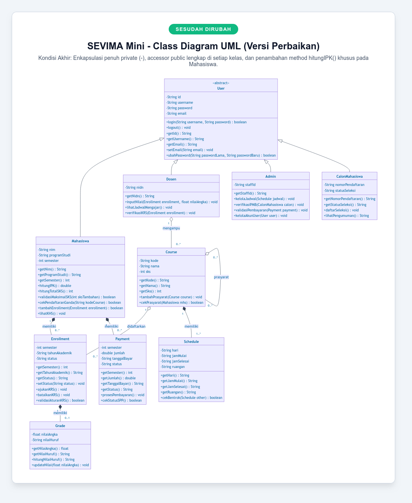
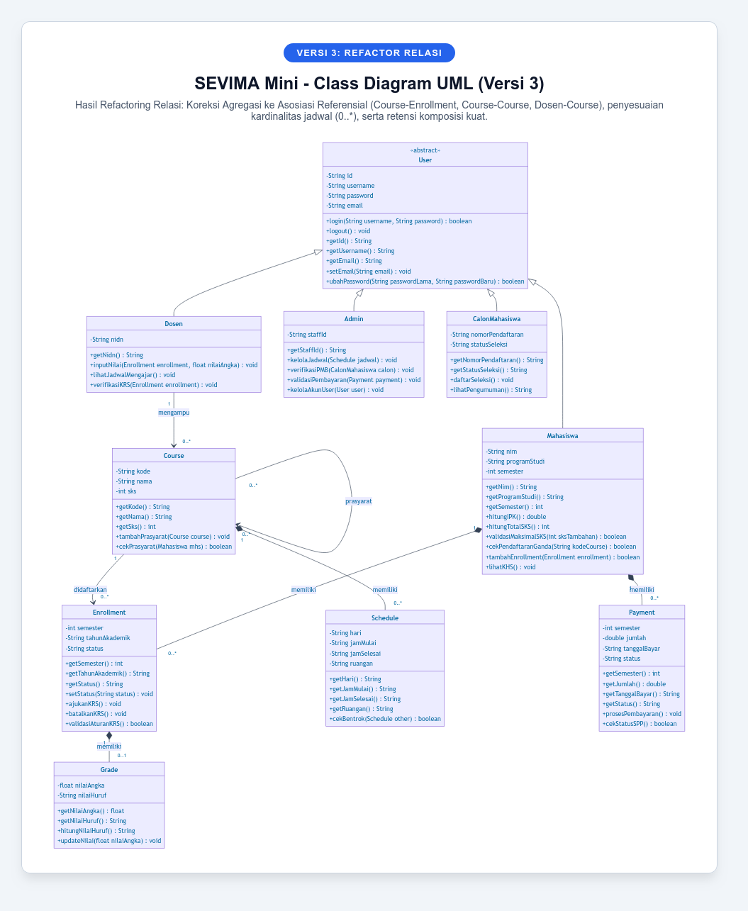

# Dokumentasi Riwayat Perbaikan Class Diagram UML - SEVIMA Mini

Dokumen ini mencatat bukti visual dan perbandingan evolusi class diagram UML sistem informasi akademik **SEVIMA Mini** dari Versi 1 hingga Versi 4 pada iterasi **Minggu 1**, serta struktur persiapan untuk iterasi berikutnya.

---

## Struktur Folder Perbaikan

- [minggu-01/](file:///home/zainun/git/istn/sevima-mini/perbaikan/minggu-01): Berisi seluruh artefak tangkapan layar (*screenshot*) bukti visual evolusi class diagram Versi 1 hingga Versi 4.
- [minggu-02/](file:///home/zainun/git/istn/sevima-mini/perbaikan/minggu-02): Berisi artefak visual Use Case Diagram SEVIMA Mini (Versi 1) dan perbaikan berikutnya.

---

## Minggu 1: Evolusi Class Diagram (Versi 1 - Versi 4)

### 1. Versi 1: Versi Awal (Draft Awal AI)

- **Karakteristik & Celah:**
  - Menggunakan visibility `protected (#)` pada atribut `User` (`id`, `username`, `email`).
  - Belum memiliki accessor publik (`getId()`, `getUsername()`, dll) pada `User`.
  - Belum memiliki method penghitungan IPK (`hitungIPK()`) pada `Mahasiswa`.
  - Menggunakan notasi agregasi (`o--`) untuk relasi non-komposisi secara berlebihan.
- **Commit Terkait:** `58f6338` (*feat: initial commit with SEVIMA Mini UML class diagram*)

---

### 2. Versi 2: Enkapsulasi Penuh & Penambahan `hitungIPK()`

- **Perubahan Utama:**
  - Enkapsulasi ketat: seluruh atribut dijadikan `private (-)`.
  - Penambahan method publik accessor/mutator pada `User`, `Admin`, `Enrollment`, dan `Payment`.
  - Penambahan method khusus `+hitungIPK() double` pada kelas `Mahasiswa` (bukan di kelas `User`).
  - Pembatasan jumlah method tetap $\le 9$ per kelas (patuh prinsip *Single Responsibility Principle*).
- **Commit Terkait:** `f5d2df3` (*docs: enrich class diagram documentation with OOP specs and business rules*)

---

### 3. Versi 3: Refactoring Relasi (Hasil Uji Wadah & Is-A)

- **Perubahan Utama:**
  - **Uji Wadah-Bagian (*Lifecycle Dependency*):**
    - `Course` $\rightarrow$ `Enrollment`: Diubah dari Agregasi (`o--`) menjadi **Asosiasi (`-->`)**, karena entitas `Course` pada katalog kurikulum bukan wadah fisik/tubuh dari transaksi pendaftaran `Enrollment`.
    - `Dosen` $\rightarrow$ `Course`: Diubah dari Agregasi (`o--`) menjadi **Asosiasi (`-->`)**, karena relasi murni peran mengajar.
    - `Course` $\rightarrow$ `Course` (Prasyarat): Diubah dari Agregasi (`o--`) menjadi **Asosiasi (`-->`)** antar sesama entitas mata kuliah setara (*self-referencing association*).
  - **Koreksi Kardinalitas:**
    - `Course "1" *-- "0..*" Schedule`: Batas minimum jadwal diubah dari `1..*` menjadi `0..*` agar mata kuliah kurikulum baru dapat dibuat sebelum penawaran jadwal disusun.
- **Commit Terkait:** `46604ef` (*feat: apply relational refactoring (version 3) and add screenshot evidence*)

---

### 4. Versi 4: Perbaikan Arsitektur Kritis 1-4 (Final Refactor)

- **Perubahan Utama:**
  1. **Integrasi Jadwal Riil (Mengatasi Masalah 1 - *Broken Operational Workflow*):**
     - Menghubungkan `Schedule "1" --> "0..*" Enrollment : diikuti` agar mahasiswa terdaftar pada sesi/ruangan spesifik, memungkinkan pengecekan bentrok jadwal riil via `Enrollment.cekBentrokJadwal()`.
     - Menghubungkan `Dosen "1" --> "0..*" Schedule : mengajar` agar fungsionalitas `Dosen.lihatJadwalMengajar()` memiliki sumber data jam dan ruangan yang valid.
  2. **Transisi Siklus Hidup PMB (Mengatasi Masalah 2 - *Rigid Lifecycle Inheritance*):**
     - Menambahkan method `CalonMahasiswa.konversiKeMahasiswa(nimBaru, prodi): Mahasiswa`.
     - Menambahkan relasi asosiasi transisi peran `CalonMahasiswa "1" --> "0..1" Mahasiswa : diterimaSebagai`.
  3. **Pemutusan Ketergantungan Siklik (Mengatasi Masalah 3 - *Circular Coupling*):**
     - Mengubah signature `Course.cekPrasyarat(Mahasiswa mhs)` menjadi `Course.cekPrasyarat(String[] kodeMatkulLulus): boolean`.
     - Menghapus ketergantungan langsung `Course` terhadap `Mahasiswa`, sehingga katalog kurikulum sepenuhnya independen dari model data mahasiswa.
  4. **Klarifikasi Tanggung Jawab KRS & SKS (Mengatasi Masalah 4 - *Role Ambiguity*):**
     - Menambahkan method delegasi `Enrollment.getSks(): int`.
     - Menjadikan validasi batas 24 SKS dan duplikasi matkul berbasis semester spesifik pada `Mahasiswa` (`validasiBebanKRS(int semester)`, `cekDuplikasiCourse(kodeCourse, semester)`).
- **Commit Terkait:** `a8fce29` (*feat: resolve architectural flaws 1-4 (version 4) and add screenshot evidence*)

---

## Minggu 2: Pemodelan Dinamis (Use Case & Sequence Diagram Versi 1)

### 1. Versi 1: Use Case Diagram SEVIMA Mini

- **Karakteristik & Implementasi:**
  - **4 Aktor:** `Mahasiswa`, `Dosen (PA)`, `Admin Akademik` (Aktor Manusia), dan `Sistem PMB` (Aktor Sistem Eksternal `<<System>>`).
  - **10 Use Case:** Terangkum utuh di dalam boundary *"SEVIMA Mini"* dengan konvensi penamaan *kata kerja + objek* dari perspektif pengguna.
  - **Relasi `<<include>>`:** `(Isi KRS) ..> (Cek Prasyarat) : <<include>>` (langkah wajib internal sistem untuk validasi kelulusan matkul prasyarat, batas 24 SKS, dan pencegahan jadwal bentrok).
  - **Relasi `<<extend>>`:**
    - `(Bayar Denda Keterlambatan) ..> (Bayar SPP) : <<extend>>` dengan extension point `[lewat jatuh tempo]`.
    - `(Ajukan Revisi KRS) ..> (Isi KRS) : <<extend>>` dengan extension point `[ditolak PA / masa KPRS]`.
- **Berkas Model:** [use-case-diagram.puml](file:///home/zainun/git/istn/sevima-mini/diagram/use-case-diagram.puml) & [use-case-diagram.md](file:///home/zainun/git/istn/sevima-mini/diagram/use-case-diagram.md)

### 2. Versi 1: Sequence Diagram Validasi KRS

- **Karakteristik & Implementasi:**
  - **6 Partisipan Terkoordinasi:** `Mahasiswa`, `KRSManager`, `KRSValidator`, `Repository`, `NotificationService`, dan `DosenPA`.
  - **Error Accumulator Pattern:** Seluruh aturan validasi (prasyarat, batas 24 SKS, jadwal bentrok) dievaluasi lengkap tanpa berhenti di error pertama (*fail-fast*), mengumpulkan semua pesan kesalahan dalam satu koleksi.
  - **Fragmen Kontrol UML:**
    - `loop`: Cek prasyarat setiap mata kuliah lewat `Repository`.
    - *Self-call*: `hitungTotalSKS` dengan validasi batas 24 SKS.
    - `opt`: Pengecekan deteksi jadwal bertabrakan.
    - `alt`: Percabangan sukses (simpan status *"pending approval"* & notifikasi asinkron via `NotificationService` ke `DosenPA`) vs gagal (mengembalikan seluruh error rincian prasyarat, SKS, dan bentrok).
- **Berkas Model:** [sequence-diagram.mmd](file:///home/zainun/git/istn/sevima-mini/diagram/sequence-diagram.mmd) & [sequence-diagram.md](file:///home/zainun/git/istn/sevima-mini/diagram/sequence-diagram.md)

---

## Tabel Komparasi Riwayat Versi

| Evaluasi Arsitektural | Versi 1 | Versi 2 | Versi 3 | Versi 4 (Final Refactor) |
| :--- | :--- | :--- | :--- | :--- |
| **Enkapsulasi Atribut** | `protected (#)` | `private (-)` | `private (-)` | `private (-)` |
| **Method `hitungIPK()`** | Tidak ada | Ada di `Mahasiswa` | Ada di `Mahasiswa` | Ada di `Mahasiswa` |
| **Keterhubungan `Schedule`** | Hanya ke `Course` | Hanya ke `Course` | Hanya ke `Course` | **Terhubung ke `Enrollment` & `Dosen`** |
| **Siklus Hidup PMB** | Subclass kaku | Subclass kaku | Subclass kaku | **Asosiasi & Method Konversi ke `Mahasiswa`** |
| **Coupling `Course`-`Mahasiswa`**| Siklik (Course butuh Mahasiswa) | Siklik | Siklik | **Terputus (Course hanya butuh `String[]`)** |
| **Tanggung Jawab KRS** | Ambigu | Ambigu | Ambigu | **SKS didelegasikan, validasi semester terstruktur** |

---

## Berkas Terkait

- Sequence Diagram Validasi KRS (Versi 1): [sequence-diagram.mmd](file:///home/zainun/git/istn/sevima-mini/diagram/sequence-diagram.mmd) & [sequence-diagram.md](file:///home/zainun/git/istn/sevima-mini/diagram/sequence-diagram.md)
- Use Case Diagram (Versi 1): [use-case-diagram.puml](file:///home/zainun/git/istn/sevima-mini/diagram/use-case-diagram.puml) & [use-case-diagram.md](file:///home/zainun/git/istn/sevima-mini/diagram/use-case-diagram.md)
- Kode Mermaid Class Diagram Versi 4: [class-diagram.mmd](file:///home/zainun/git/istn/sevima-mini/diagram/class-diagram.mmd)
- Spesifikasi Teknis & Aturan Bisnis Class Diagram: [class-diagram.md](file:///home/zainun/git/istn/sevima-mini/diagram/class-diagram.md)
- Dokumen Keputusan Arsitektur: [ADR-001.pdf](file:///home/zainun/git/istn/sevima-mini/documents/ADR-001.pdf)
- Catatan Transparansi AI: [ai-usage-log.md](file:///home/zainun/git/istn/sevima-mini/logs/ai-usage-log.md)
